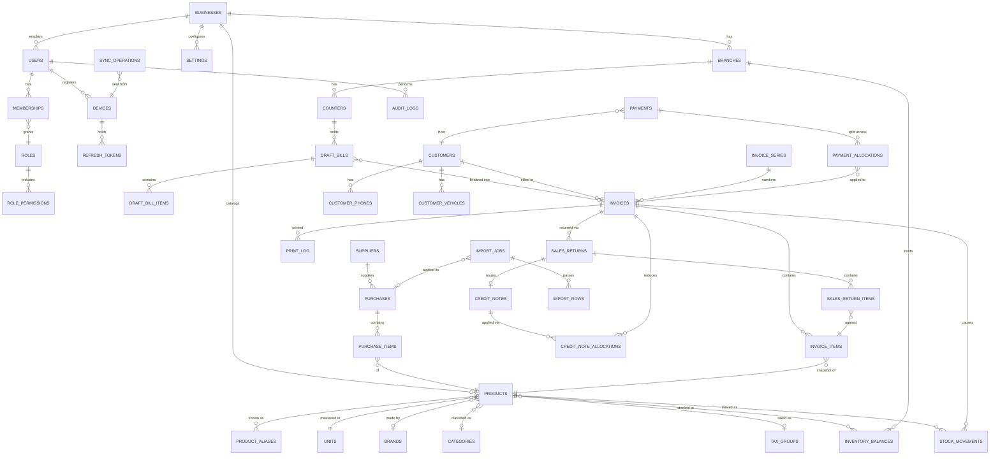

# Data Model — `bmbackend`

| Field | Value |
|---|---|
| Status | **Phase 1 proposal — no schema exists, no migration has been written or run** |
| Database | PostgreSQL 16 |
| Last updated | 2026-10-29 |

> **Nothing in this document has been applied to any database.** No migration was generated and no
> DDL was executed during Phase 1.

---

## 1. Conventions

| Convention | Rule |
|---|---|
| Primary keys | `uuid` (v7 preferred for index locality; v4 acceptable). **Client-generatable** for `draft_bills`, `draft_bill_items`, `customers` so offline creation is idempotent. |
| Tenancy | Every business-scoped table carries a non-null `business_id`. Branch-scoped tables also carry `branch_id`. |
| Timestamps | `created_at`, `updated_at` as `timestamptz NOT NULL DEFAULT now()`. Server time is authoritative; client-supplied times are stored in separate `client_*` columns. |
| Money | `NUMERIC(14,2)` for amounts, `NUMERIC(14,4)` for unit prices, `NUMERIC(6,3)` for percentages. **Never** `float`/`double`/`money`. |
| Quantity | `NUMERIC(14,3)`. Integer-only units are enforced in the domain layer, not by the column type. |
| Deletion | Financial, stock and audit tables are **append-only**: no `DELETE`, no mutation of issued records. Reference data uses `is_active` (soft deactivate), never hard delete once referenced. |
| Enums | PostgreSQL native `ENUM` types for closed sets that change rarely (movement reason, payment status); lookup tables where the owner may add values (adjustment reasons, payment methods). |
| Naming | `snake_case`, plural table names, `<table>_id` foreign keys, indexes `ix_<table>__<cols>`, uniques `uq_<table>__<cols>`, checks `ck_<table>__<rule>`. |
| Normalised search columns | `normalized_*` columns are maintained by the application (not triggers) so the normalisation rule lives in one testable place. |

---

## 2. Entity relationship overview



---

## 3. Tables

Notation: `PK` primary key, `FK` foreign key, `NN` not null, `U` part of a unique constraint.

### 3.1 Tenancy and administration

#### `businesses`
| Column | Type | Notes |
|---|---|---|
| `id` | uuid PK | |
| `legal_name` | text | **Nullable until owner supplies it.** Blank blocks go-live, not startup. |
| `display_name` | text NN | Invoice heading, e.g. `NATIONAL AUTO SPARES` — owner-supplied, never defaulted |
| `address_lines` | text[] NN default `'{}'` | Printed as-is |
| `phone_numbers` | text[] NN default `'{}'` | |
| `email` | text | |
| `tax_identifier` | text | GSTIN when confirmed. Null while `tax.mode = estimate_only` |
| `tax_identifier_type` | text | e.g. `gstin`. Null until confirmed |
| `state_code` | text | Needed only if GST is enabled (place of supply) |
| `financial_year_start_month` | smallint NN default 4 | Drives invoice-series year rollover |
| `created_at`, `updated_at` | timestamptz NN | |

#### `branches`
`id` PK · `business_id` FK NN U · `code` text NN U *(unique per business)* · `name` text NN ·
`address_lines` text[] · `phone` text · `is_active` bool NN default true · timestamps
Unique: `uq_branches__business_code (business_id, code)`

#### `counters`
`id` PK · `business_id` FK NN · `branch_id` FK NN · `code` text NN · `name` text NN ·
`max_open_drafts` int NN default 20 `CHECK (max_open_drafts >= 20)` · `invoice_series_id` FK NULL
*(optional per-counter series — the escalation path in ARCHITECTURE §5.4)* ·
`is_active` bool NN default true · timestamps
Unique: `uq_counters__branch_code (branch_id, code)`

#### `settings`
`id` PK · `business_id` FK NN · `branch_id` FK NULL *(null = business-wide)* · `key` text NN ·
`value` jsonb NN · `value_type` text NN · `updated_by_user_id` FK · `updated_at` timestamptz NN
Unique: `uq_settings__scope_key (business_id, coalesce(branch_id,'00000000-0000-0000-0000-000000000000'), key)`

Documented defaults (applied in code, not rows, so an unset key is never ambiguous):

| Key | Default | Used by |
|---|---|---|
| `tax.mode` | `estimate_only` | FR-TAX-001 |
| `drafts.max_open_per_counter` | 20 | FR-DRAFT-002 |
| `drafts.stale_days` | 7 | FR-DRAFT-009 |
| `drafts.retention_days` | 180 | ARCHITECTURE §11 |
| `sales.cancel_window_hours` | 24 | FR-SALE-011 |
| `sales.rounding_mode` | `line_half_up` | Q-MONEY-1 |
| `sales.round_grand_total_to_rupee` | false | Q-MONEY-1 |
| `returns.window_days` | 30 | FR-RET-004 |
| `credit.default_terms_days` | 30 | FR-CREDIT-005 |
| `credit.enforce_limit` | false | FR-CREDIT-006 |
| `discount.cashier_max_percent` | 0 | §3.2 of PRD |
| `inventory.allow_oversell_override` | true | FR-SALE-008 |
| `imports.max_file_mb` | 10 | FR-IMP-001 |
| `idempotency.retention_days` | 7 | ARCHITECTURE §5.3 |
| `sync.catalog_cache_max_rows` | 5000 | FR-OFFLINE-008 |
| `sync.finalization_stale_minutes` | 60 | `OFFLINE-SYNCHRONIZATION.md §8` — when a pending finalisation stops auto-retrying |
| `print.mark_reprints_duplicate` | true | FR-PRINT-004 |

### 3.2 Identity and access

#### `users`
`id` PK · `business_id` FK NN · `username` citext NN · `full_name` text NN ·
`password_hash` text NN *(Argon2id)* · `pin_hash` text NULL · `must_change_password` bool NN
default false · `is_active` bool NN default true · `last_login_at` timestamptz · timestamps
Unique: `uq_users__business_username (business_id, username)`

#### `roles` / `permissions` / `role_permissions`
`roles`: `id` PK · `business_id` FK NULL *(null = system role)* · `code` text NN · `name` text NN ·
`is_system` bool NN
`permissions`: `code` text PK · `description` text NN
`role_permissions`: `role_id` FK · `permission_code` FK — PK `(role_id, permission_code)`

#### `memberships`
`id` PK · `user_id` FK NN · `business_id` FK NN · `branch_id` FK NULL *(null = all branches)* ·
`role_id` FK NN · `is_active` bool NN · timestamps
Unique: `uq_memberships__user_branch_role (user_id, coalesce(branch_id,…), role_id)`

#### `devices`
`id` PK *(client-generated, stable per browser profile)* · `business_id` FK NN · `branch_id` FK ·
`counter_id` FK NULL · `label` text NN · `user_agent` text · `status` enum(`active`,`revoked`) NN
default `active` · `revoked_at` timestamptz · `revoked_by_user_id` FK · `revoke_reason` text ·
`last_seen_at` timestamptz · timestamps

#### `refresh_tokens`
`id` PK · `user_id` FK NN · `device_id` FK NN · `family_id` uuid NN · `token_hash` text NN U ·
`issued_at` timestamptz NN · `expires_at` timestamptz NN · `consumed_at` timestamptz ·
`revoked_at` timestamptz · `replaced_by_id` FK NULL
Index: `ix_refresh_tokens__family (family_id)` — reuse detection revokes the whole family.

#### `login_attempts`
`id` PK · `business_id` FK NULL · `username_attempted` citext · `ip_hash` text · `succeeded` bool NN
· `reason` text · `created_at` timestamptz NN
Index on `(username_attempted, created_at desc)` and `(ip_hash, created_at desc)` for rate limiting.

### 3.3 Catalog

#### `units`
`id` PK · `business_id` FK NN · `code` text NN U · `name` text NN · `allows_fraction` bool NN default
false · `decimal_places` smallint NN default 0 `CHECK (decimal_places BETWEEN 0 AND 3)`

#### `brands`, `categories`
`id` PK · `business_id` FK NN · `name` text NN · `normalized_name` text NN ·
`is_active` bool NN — Unique `(business_id, normalized_name)`

#### `products`
| Column | Type | Notes |
|---|---|---|
| `id` | uuid PK | |
| `business_id` | uuid FK NN | |
| `name` | text NN | As printed on the bill |
| `normalized_name` | text NN | lower + unaccent + collapsed whitespace |
| `sku` | text NULL | Part code as entered |
| `normalized_sku` | text NULL | lower, separators (`-`,`/`,`.`,space) stripped |
| `barcode` | text NULL | |
| `brand_id`, `category_id`, `unit_id` | uuid FK | `unit_id` NN |
| `tax_group_id` | uuid FK NULL | Required before `gst_enabled` (FR-TAX-003) |
| `hsn_code` | text NULL | Unconfirmed requirement |
| `default_selling_price` | NUMERIC(14,4) NN | `CHECK (>= 0)` |
| `last_cost_price` | NUMERIC(14,4) NULL | Visible only with `catalog.cost.read` |
| `reorder_level` | NUMERIC(14,3) NULL | |
| `is_active` | bool NN default true | Soft deactivate only |
| `search_text` | text NN | name + sku + brand + aliases, normalised; maintained by the app |
| `sales_rank` | int NN default 0 | Periodically refreshed; stable tie-break for search |
| timestamps | | |

Constraints and indexes:
```
uq_products__business_sku      UNIQUE (business_id, normalized_sku) WHERE normalized_sku IS NOT NULL
uq_products__business_barcode  UNIQUE (business_id, barcode)        WHERE barcode IS NOT NULL
ix_products__sku_prefix        (business_id, normalized_sku text_pattern_ops)
ix_products__name_prefix       (business_id, normalized_name text_pattern_ops)
ix_products__search_trgm       GIN (search_text gin_trgm_ops)
ix_products__active            (business_id, is_active) WHERE is_active
ck_products__price_nonneg      CHECK (default_selling_price >= 0)
```

#### `product_aliases`
`id` PK · `business_id` FK NN · `product_id` FK NN · `alias` text NN · `normalized_alias` text NN ·
`alias_type` enum(`alternate_name`,`old_part_no`,`oem_no`,`local_name`,`competitor_no`) NN ·
timestamps
Unique: `uq_product_aliases__business_alias (business_id, normalized_alias, alias_type)`
Index: `ix_product_aliases__prefix (business_id, normalized_alias text_pattern_ops)`

#### `product_prices` *(price history, P2)*
`id` PK · `business_id` FK NN · `product_id` FK NN · `selling_price` NUMERIC(14,4) NN ·
`effective_from` timestamptz NN · `effective_to` timestamptz NULL · `changed_by_user_id` FK ·
`reason` text — invoices never read this table; they carry their own snapshot.

### 3.4 Inventory

#### `inventory_balances`
| Column | Type | Notes |
|---|---|---|
| `id` | uuid PK | |
| `business_id`, `branch_id`, `product_id` | uuid FK NN | |
| `quantity` | NUMERIC(14,3) NN default 0 | May be negative **only** via an audited oversell override |
| `last_movement_id` | uuid FK NULL | Cheap staleness check during reconciliation |
| `updated_at` | timestamptz NN | |

```
uq_inventory_balances__branch_product UNIQUE (branch_id, product_id)
ix_inventory_balances__low  (branch_id, product_id) INCLUDE (quantity)
```
This is the row locked `FOR UPDATE` during finalisation. One row per product per branch keeps the
lock set small and ordered.

#### `stock_movements` — append-only ledger
| Column | Type | Notes |
|---|---|---|
| `id` | uuid PK | |
| `business_id`, `branch_id`, `product_id` | uuid FK NN | |
| `quantity_delta` | NUMERIC(14,3) NN | Signed. `CHECK (quantity_delta <> 0)` |
| `balance_after` | NUMERIC(14,3) NN | Written in the same transaction; makes ledger audit readable |
| `reason` | enum NN | `opening`, `purchase_receipt`, `sale`, `sale_cancellation`, `customer_return`, `supplier_return`, `adjustment_increase`, `adjustment_decrease`, `transfer_out`, `transfer_in`, `import_apply`, `scrap` |
| `source_type` | text NN | `invoice`, `purchase`, `sales_return`, `adjustment`, `import_job`, `opening` |
| `source_id` | uuid NN | The document that caused it |
| `unit_cost` | NUMERIC(14,4) NULL | For valuation; snapshot |
| `oversell_override` | bool NN default false | True only on the override path |
| `override_reason` | text NULL | `CHECK (NOT oversell_override OR length(override_reason) >= 10)` |
| `created_by_user_id`, `counter_id`, `device_id` | FK | Who/where |
| `created_at` | timestamptz NN | |

```
ix_stock_movements__product_time (branch_id, product_id, created_at desc)
ix_stock_movements__source       (source_type, source_id)
```
Database-level protection: the application role is granted `INSERT`/`SELECT` only — no `UPDATE`,
no `DELETE` (see `SECURITY.md §7`). This makes NFR-DATA-006 structural rather than aspirational.

#### `stock_count_sessions` / `stock_count_items` *(P1)*
Session: `id` PK · `branch_id` FK · `status` enum(`open`,`applied`,`cancelled`) · `counted_by` FK ·
`applied_at` · `notes`. Items: `product_id` · `system_quantity` NUMERIC(14,3) ·
`counted_quantity` NUMERIC(14,3) · `variance` generated. Applying creates adjustment movements in
one transaction.

### 3.5 Suppliers and purchases

#### `suppliers`
`id` PK · `business_id` FK NN · `name` text NN · `normalized_name` text NN · `business_name` text ·
`phone` text · `address_lines` text[] · `tax_identifier` text · `notes` text ·
`is_active` bool NN · timestamps — Unique `(business_id, normalized_name)`

#### `purchases` *(goods receipt)*
`id` PK · `business_id` FK NN · `branch_id` FK NN · `supplier_id` FK NN ·
`supplier_document_number` text NULL · `document_date` date NULL · `received_at` timestamptz NN ·
`status` enum(`draft`,`confirmed`,`cancelled`) NN · `subtotal` NUMERIC(14,2) NN ·
`tax_total` NUMERIC(14,2) NN default 0 · `total` NUMERIC(14,2) NN · `notes` text ·
`import_job_id` FK NULL · `created_by_user_id` FK NN · timestamps
Unique: `uq_purchases__supplier_doc (business_id, supplier_id, supplier_document_number)
WHERE supplier_document_number IS NOT NULL` — blocks double-receiving the same supplier invoice
(FR-PUR-006).
**Only the `draft → confirmed` transition creates stock movements** (FR-PUR-003).

#### `purchase_items`
`id` PK · `purchase_id` FK NN · `product_id` FK NN · `product_name_snapshot` text NN ·
`quantity` NUMERIC(14,3) NN `CHECK (> 0)` · `unit_cost` NUMERIC(14,4) NN `CHECK (>= 0)` ·
`line_total` NUMERIC(14,2) NN · `line_no` int NN
Unique `(purchase_id, line_no)`

### 3.6 Draft bills

#### `draft_bills`
| Column | Type | Notes |
|---|---|---|
| `id` | uuid PK | **Client-generated** (FR-DRAFT-001) |
| `business_id`, `branch_id`, `counter_id` | uuid FK NN | Ownership |
| `label` | text NULL | Tab label; defaults to a sequence number in the UI |
| `status` | enum(`open`,`finalized`,`cancelled`,`stale`) NN default `open` | |
| `version` | int NN default 1 | Optimistic concurrency (FR-DRAFT-004) |
| `customer_id` | uuid FK NULL | Set for credit sales |
| `customer_name`, `customer_business_name`, `vehicle_number`, `mechanic_name`, `phone` | text NULL | Free text until a customer record is attached |
| `notes` | text NULL | |
| `is_credit_intent` | bool NN default false | Hint only; finalisation decides |
| `preview_total` | NUMERIC(14,2) NULL | Advisory (FR-DRAFT-011) |
| `invoice_id` | uuid FK NULL U | Set on finalisation; `UNIQUE` prevents double-finalisation |
| `created_by_user_id`, `last_edited_by_user_id`, `device_id` | FK | |
| `client_created_at` | timestamptz NULL | Diagnostics only |
| `created_at`, `updated_at` | timestamptz NN | Server authoritative |

```
uq_draft_bills__invoice   UNIQUE (invoice_id) WHERE invoice_id IS NOT NULL
ix_draft_bills__open      (counter_id, status) WHERE status = 'open'
ck_draft_bills__finalized CHECK ((status = 'finalized') = (invoice_id IS NOT NULL))
```

#### `draft_bill_items`
`id` PK *(client-generated)* · `draft_bill_id` FK NN · `line_no` int NN ·
`product_id` FK NN · `product_name_snapshot` text NN · `quantity` NUMERIC(14,3) NN `CHECK (> 0)` ·
`unit_price` NUMERIC(14,4) NN `CHECK (>= 0)` · `catalog_price_at_add` NUMERIC(14,4) NN ·
`price_source` enum(`catalog`,`manual_override`) NN · `discount_percent` NUMERIC(6,3) NN default 0 ·
`discount_amount` NUMERIC(14,2) NN default 0 · `line_total_preview` NUMERIC(14,2) NN · `notes` text
Unique `(draft_bill_id, line_no)`

### 3.7 Customers

#### `customers`
`id` PK *(client-generatable)* · `business_id` FK NN · `name` text NN · `normalized_name` text NN ·
`business_name` text · `address_lines` text[] · `default_mechanic_name` text ·
`credit_terms_days` int NULL · `credit_limit` NUMERIC(14,2) NULL ·
`is_active` bool NN · `notes` text · `created_by_user_id` FK · timestamps
Index: `ix_customers__name_trgm GIN (normalized_name gin_trgm_ops)`

#### `customer_phones`
`id` PK · `customer_id` FK NN · `business_id` FK NN · `phone` text NN · `normalized_phone` text NN ·
`is_primary` bool NN
Unique: `uq_customer_phones__business_phone (business_id, normalized_phone)` — this is the duplicate
detector for FR-CUST-004.

#### `customer_vehicles`
`id` PK · `customer_id` FK NN · `business_id` FK NN · `vehicle_number` text NN *(as entered,
printed verbatim)* · `normalized_vehicle_number` text NN *(uppercase, separators stripped)* ·
`description` text
Index: `ix_customer_vehicles__normalized (business_id, normalized_vehicle_number)`

### 3.8 Invoices

#### `invoice_series`
| Column | Type | Notes |
|---|---|---|
| `id` | uuid PK | |
| `business_id`, `branch_id` | uuid FK NN | |
| `series_code` | text NN | e.g. `NAS`, or per-counter `NAS-C1` |
| `financial_year` | text NN | e.g. `2026-27`, derived from `financial_year_start_month` |
| `prefix_template` | text NN | e.g. `NAS/{fy}/{seq:05d}` — formats the **internal** reference only. `NAS` remains a placeholder pending [OD-4](OWNER-DECISIONS.md#od-4). **Not customer-visible** |
| `next_number` | int NN default 1 | Locked `FOR UPDATE` inside finalisation |
| `document_kind` | enum(`estimate`,`tax_invoice`) NN | Follows `tax.mode`; a series never changes kind mid-year |
| `is_active` | bool NN | |

Unique: `uq_invoice_series__scope (business_id, branch_id, series_code, financial_year)`

#### `invoices`
| Column | Type | Notes |
|---|---|---|
| `id` | uuid PK | |
| `business_id`, `branch_id`, `counter_id` | uuid FK NN | |
| `invoice_series_id` | uuid FK NN | |
| `invoice_number` | text NN | **INTERNAL reference string only** — e.g. `NAS/2026-27/00412`. ⚠️ **Never rendered to a customer and never present in `print_payload`** ([OD-3](OWNER-DECISIONS.md#od-3) re-answered: no customer-visible invoice numbering). Retained for audit, reconciliation and the [OD-25](OWNER-DECISIONS.md#od-25) contingency |
| `sequence_number` | int NN | Numeric part of the internal reference; supports uniqueness and stable ordering |
| `document_kind` | enum(`estimate`,`tax_invoice`) NN | Snapshot at issue time (FR-PRINT-002) |
| `status` | enum(`issued`,`cancelled`) NN default `issued` | One-way |
| `issued_at` | timestamptz NN | Server time; the sale date for reports |
| `customer_id` | uuid FK NULL | NN when `is_credit` |
| `customer_name_snapshot`, `customer_business_name_snapshot`, `vehicle_number_snapshot`, `mechanic_name_snapshot`, `phone_snapshot` | text | Printed exactly as sold |
| `is_credit` | bool NN default false | |
| `due_date` | date NULL | From credit terms |
| `subtotal` | NUMERIC(14,2) NN | Sum of line totals before invoice-level discount/tax |
| `discount_total` | NUMERIC(14,2) NN default 0 | |
| `tax_total` | NUMERIC(14,2) NN default 0 | Always 0 in `estimate_only` |
| `rounding_adjustment` | NUMERIC(14,2) NN default 0 | Keeps arithmetic reconcilable |
| `total` | NUMERIC(14,2) NN | |
| `amount_paid` | NUMERIC(14,2) NN default 0 | **Derived cache**, written only with allocations |
| `payment_status` | enum(`unpaid`,`partially_paid`,`paid`,`overpaid`,`cancelled`) NN | Computed, never user-set (FR-CREDIT-003) |
| `cost_total` | NUMERIC(14,2) NULL | Snapshot for margin reports |
| `oversell_override` | bool NN default false | |
| `oversell_reason` | text NULL | |
| `price_changes_accepted` | bool NN default false | Audit trail for FR-SALE-006 |
| `tax_config_version_id` | uuid FK NULL | Which tax rules applied |
| `cancelled_at`, `cancelled_by_user_id`, `cancellation_reason` | | `CHECK` all-or-none with `status` |
| `draft_bill_id` | uuid FK NULL | Provenance |
| `created_by_user_id`, `device_id` | FK NN | |
| `idempotency_key` | text NULL | For forensic tracing |
| `notes` | text | |
| timestamps | | |

```
uq_invoices__series_sequence UNIQUE (invoice_series_id, sequence_number)
uq_invoices__business_number UNIQUE (business_id, invoice_number)
ix_invoices__branch_issued   (branch_id, issued_at desc)
ix_invoices__customer_status (customer_id, payment_status) WHERE is_credit
ix_invoices__outstanding     (business_id, due_date) WHERE payment_status IN ('unpaid','partially_paid')
ck_invoices__total           CHECK (total = subtotal - discount_total + tax_total + rounding_adjustment)
ck_invoices__credit_customer CHECK (NOT is_credit OR customer_id IS NOT NULL)
ck_invoices__cancel_fields   CHECK ((status='cancelled') = (cancelled_at IS NOT NULL))
ck_invoices__oversell_reason CHECK (NOT oversell_override OR length(oversell_reason) >= 10)
```

`ck_invoices__total` makes NFR-DATA-002 a database guarantee, not just a test.

#### `invoice_items` — immutable snapshots
`id` PK · `invoice_id` FK NN · `business_id` FK NN · `line_no` int NN ·
`product_id` FK NN *(reference only)* · `product_name_snapshot` text NN ·
`sku_snapshot` text · `unit_code_snapshot` text NN · `hsn_snapshot` text ·
`quantity` NUMERIC(14,3) NN `CHECK (> 0)` · `unit_price` NUMERIC(14,4) NN `CHECK (>= 0)` ·
`discount_percent` NUMERIC(6,3) NN default 0 · `discount_amount` NUMERIC(14,2) NN default 0 ·
`taxable_amount` NUMERIC(14,2) NN · `tax_rate_snapshot` NUMERIC(6,3) NN default 0 ·
`tax_amount` NUMERIC(14,2) NN default 0 · `line_total` NUMERIC(14,2) NN ·
`unit_cost_snapshot` NUMERIC(14,4) NULL · `returned_quantity` NUMERIC(14,3) NN default 0 ·
`price_source` enum(`catalog`,`manual_override`) NN · `catalog_price_at_sale` NUMERIC(14,4) NN
```
uq_invoice_items__line      UNIQUE (invoice_id, line_no)
ix_invoice_items__product   (product_id, invoice_id)
ck_invoice_items__returned  CHECK (returned_quantity >= 0 AND returned_quantity <= quantity)
```
`returned_quantity` is the only mutable column on this table, updated solely by the returns module
under a row lock — that is what makes NFR-DATA-008 enforceable at the database level.

#### `print_log` *(P1)*
`id` PK · `invoice_id` FK NN · `printed_by_user_id` FK · `device_id` FK · `copy_number` int NN ·
`is_duplicate` bool NN · `printed_at` timestamptz NN

### 3.9 Payments and credit

#### `payments`
`id` PK · `business_id` FK NN · `branch_id` FK NN · `counter_id` FK NULL · `customer_id` FK NULL ·
`direction` enum(`received`,`refunded`) NN default `received` ·
`kind` enum(`payment`,`reversal`) NN default `payment` · `reverses_payment_id` FK NULL ·
`amount` NUMERIC(14,2) NN `CHECK (> 0)` ·
`method` enum(`cash`,`upi`,`card`,`bank_transfer`,`cheque`,`adjustment`) NN ·
`reference` text NULL *(UPI ref / cheque no — no instrument data)* ·
`allocation_strategy` enum(`manual`,`oldest_first`,`invoice_specific`) NN ·
`received_at` timestamptz NN · `received_by_user_id` FK NN · `device_id` FK ·
`idempotency_key` text NULL · `notes` text · `created_at` timestamptz NN
```
ix_payments__customer_time (customer_id, received_at desc)
ix_payments__branch_day    (branch_id, received_at)
ck_payments__reversal      CHECK ((kind='reversal') = (reverses_payment_id IS NOT NULL))
```
Append-only. A mistake is corrected by a `reversal` row (FR-PAY-005).

#### `payment_allocations`
`id` PK · `business_id` FK NN · `payment_id` FK NN · `invoice_id` FK NN ·
`amount` NUMERIC(14,2) NN `CHECK (> 0)` · `created_at` timestamptz NN
```
uq_payment_allocations__pair UNIQUE (payment_id, invoice_id)
ix_payment_allocations__invoice (invoice_id)
```
Invariants NFR-DATA-003/004 are asserted by tests plus the nightly reconciliation job; they cannot
be expressed as single-row `CHECK`s.

#### `credit_notes`
`id` PK · `business_id` FK NN · `branch_id` FK NN · `customer_id` FK NULL ·
`note_number` text NN U · `source_type` enum(`sales_return`,`cancellation`,`write_off`,`adjustment`) NN ·
`source_id` uuid NULL · `original_invoice_id` FK NULL · `amount` NUMERIC(14,2) NN `CHECK (> 0)` ·
`reason` text NN · `issued_at` timestamptz NN · `created_by_user_id` FK NN · `status`
enum(`open`,`fully_allocated`,`refunded`,`cancelled`) NN

#### `credit_note_allocations`
`id` PK · `credit_note_id` FK NN · `invoice_id` FK NN · `amount` NUMERIC(14,2) NN `CHECK (> 0)` ·
`created_at` — Unique `(credit_note_id, invoice_id)`

#### `customer_credit_balances` *(derived cache, P1)*
`customer_id` PK · `business_id` FK NN · `outstanding_total` NUMERIC(14,2) NN ·
`on_account_credit` NUMERIC(14,2) NN · `oldest_due_date` date · `recomputed_at` timestamptz NN —
rebuildable from source at any time; never authoritative.

#### Customer-wise credit grouping — **no new entity required**

The owner's customer-wise Credit Bills view (FR-RPT-028, FR-CREDIT-011) was assessed against the
existing schema. **It needs no new table, no per-customer folder, and no structural change.**

| Requirement | Satisfied by |
|---|---|
| Every credit invoice belongs to a stable customer | `invoices.customer_id` FK → `customers.id` (uuid, immutable), enforced `NOT NULL` for credit by `ck_invoices__credit_customer` |
| One customer, many invoices | Ordinary one-to-many; already indexed `ix_invoices__customer_status (customer_id, payment_status) WHERE is_credit` |
| All of a customer's invoices together | `WHERE customer_id = ? AND is_credit` on that index |
| Per-invoice number, date, total, paid, outstanding, status | `invoices.invoice_number`, `issued_at`, `total`, `amount_paid`, `payment_status`; outstanding derived (FR-CREDIT-002) |
| Per-customer and overall outstanding totals | Aggregate over `invoices` + `payment_allocations`; optionally served from `customer_credit_balances` |
| Payment history per invoice | `payment_allocations` → `payments` |
| **Rename must not break associations** | Grouping keys on `customer_id`; `customers.name` is a display label only (FR-CUST-011) |
| Settled invoices stay visible | Nothing is deleted; `payment_status = 'paid'` distinguishes them (FR-RPT-031) |

**Deliberately rejected: a table or directory per customer.** It would add an entity with no data of
its own, require creation/cleanup on every customer change, and turn a rename into a migration —
while an indexed foreign key already answers every query. "Customer-wise" is a **presentation**
concern, satisfied by `GET /credit/customers` (an aggregate query) plus the existing invoice
endpoint filtered by `customer_id`.

The only index worth adding for this view:
```
ix_invoices__customer_outstanding (business_id, customer_id, issued_at desc)
    WHERE is_credit AND payment_status IN ('unpaid','partially_paid')
```

### 3.10 Returns

#### `sales_returns`
`id` PK · `business_id` FK NN · `branch_id` FK NN · `invoice_id` FK NN · `return_number` text NN U ·
`returned_at` timestamptz NN · `reason` text NN · `restock` bool NN default true ·
`credit_note_id` FK NULL · `total_amount` NUMERIC(14,2) NN · `created_by_user_id` FK NN ·
`device_id` FK · `idempotency_key` text

#### `sales_return_items`
`id` PK · `sales_return_id` FK NN · `invoice_item_id` FK NN · `product_id` FK NN ·
`quantity` NUMERIC(14,3) NN `CHECK (> 0)` · `unit_price_snapshot` NUMERIC(14,4) NN ·
`line_amount` NUMERIC(14,2) NN · `condition` enum(`resalable`,`damaged`) NN
Unique `(sales_return_id, invoice_item_id)`

### 3.11 Imports

#### `import_jobs`
`id` PK · `business_id` FK NN · `branch_id` FK NN ·
`intent` enum(`price_list`,`purchase_receipt`) NN *(FR-IMP-002)* ·
`supplier_id` FK NULL `CHECK (intent <> 'purchase_receipt' OR supplier_id IS NOT NULL)` ·
`original_filename` text NN · `stored_object_key` text NN · `content_type` text NN ·
`file_size_bytes` bigint NN · `file_sha256` text NN ·
`status` enum(`uploaded`,`parsing`,`parsed`,`needs_review`,`applying`,`applied`,`failed`,`cancelled`) NN ·
`duplicate_of_job_id` FK NULL · `duplicate_override_reason` text NULL ·
`row_count`, `rows_applied`, `rows_skipped`, `rows_failed` int NN default 0 ·
`error_summary` text · `created_purchase_id` FK NULL ·
`uploaded_by_user_id` FK NN · `applied_by_user_id` FK NULL · `applied_at` timestamptz · timestamps
```
uq_import_jobs__file UNIQUE (business_id, file_sha256)   -- FR-IMP-004 / E-9
```

#### `import_rows`
`id` PK · `import_job_id` FK NN · `row_index` int NN · `raw_values` jsonb NN ·
`parsed_name` text · `parsed_sku` text · `parsed_quantity` NUMERIC(14,3) ·
`parsed_unit_cost` NUMERIC(14,4) · `parsed_selling_price` NUMERIC(14,4) ·
`match_status` enum(`exact_sku`,`exact_alias`,`fuzzy_candidate`,`ambiguous`,`new_product`,
`duplicate_in_file`,`invalid`) NN · `matched_product_id` FK NULL ·
`candidate_product_ids` uuid[] · `match_confidence` NUMERIC(5,4) ·
`decision` enum(`pending`,`accept_match`,`create_new`,`skip`) NN default `pending` ·
`decided_by_user_id` FK NULL · `apply_result` enum(`applied`,`skipped`,`failed`) NULL ·
`apply_error` text
Unique `(import_job_id, row_index)`; `ck_import_rows__decision_required CHECK (match_status NOT IN
('ambiguous','new_product','duplicate_in_file','invalid') OR decision <> 'pending' OR apply_result
IS NULL)` — encodes FR-IMP-007.

### 3.12 Infrastructure tables

#### `idempotency_keys`
`id` PK · `business_id` FK NN · `endpoint` text NN · `key` text NN · `request_fingerprint` text NN ·
`status` enum(`in_progress`,`completed`) NN · `response_status` int NULL ·
`response_body` jsonb NULL · `resource_type` text · `resource_id` uuid ·
`user_id` FK · `device_id` FK · `created_at` NN · `completed_at`
Unique: `uq_idempotency__scope (business_id, endpoint, key)`

#### `sync_operations`
`id` PK *(= client `op_id`)* · `business_id` FK NN · `device_id` FK NN · `user_id` FK NN ·
`operation_type` text NN · `entity_type` text NN · `entity_id` uuid NN ·
`client_seq` bigint NN · `base_version` int NULL · `payload` jsonb NN ·
`status` enum(`accepted`,`replayed`,`conflicted`,`rejected`) NN ·
`error_code` text · `error_detail` jsonb ·
`client_created_at` timestamptz NULL · `server_received_at` timestamptz NN *(authoritative,
FR-OFFLINE-007)*
```
ix_sync_operations__device_seq (device_id, client_seq)
ix_sync_operations__entity     (entity_type, entity_id, server_received_at desc)
```

#### `audit_logs`
`id` PK · `business_id` FK NN · `branch_id` FK NULL · `actor_user_id` FK NULL ·
`device_id` FK NULL · `counter_id` FK NULL · `action` text NN *(e.g. `sale.finalized`,
`inventory.oversell_override`, `invoice.cancelled`, `tax.mode_changed`)* ·
`entity_type` text NN · `entity_id` uuid NULL · `reason` text NULL ·
`before_value` jsonb NULL · `after_value` jsonb NULL · `request_id` text NULL ·
`ip_hash` text NULL · `created_at` timestamptz NN

```
ix_audit_logs__entity (entity_type, entity_id, created_at desc)
ix_audit_logs__actor  (actor_user_id, created_at desc)
ix_audit_logs__action (business_id, action, created_at desc)
```
Append-only, enforced by revoking `UPDATE`/`DELETE` from the application role.

#### `jobs` *(queue)*
`id` PK · `kind` text NN · `payload` jsonb NN · `status` enum(`queued`,`running`,`succeeded`,
`failed`,`dead`) NN · `attempts` int NN default 0 · `max_attempts` int NN default 5 ·
`run_after` timestamptz NN default now() · `locked_by` text · `locked_at` timestamptz ·
`last_error` text · `dedupe_key` text NULL U · timestamps
Index: `ix_jobs__claim (status, run_after) WHERE status = 'queued'`
Unique: `uq_jobs__dedupe (dedupe_key) WHERE dedupe_key IS NOT NULL`

#### `outbox_events`
`id` PK · `business_id` FK NN · `event_type` text NN · `aggregate_type` text NN ·
`aggregate_id` uuid NN · `payload` jsonb NN · `status` enum(`pending`,`dispatched`,`failed`) NN ·
`attempts` int NN · `dispatched_at` · `created_at` NN

#### `notifications` *(P1)*
`id` PK · `business_id` FK NN · `kind` enum(`low_stock`,`overdue_credit`,`reconciliation_alert`,
`import_complete`) NN · `severity` enum(`info`,`warning`,`critical`) NN · `title` text NN ·
`body` text · `entity_type` text · `entity_id` uuid · `read_at` timestamptz NULL · `created_at` NN

> *Phase 2 closure (audit finding CF-10): `jobs`, `outbox_events` and `notifications` were previously
> nested under the canonical-identifiers section below, and the tax section was numbered `3.13` yet
> printed after `3.14`. The three infrastructure tables now sit in this section where they belong,
> and the tax section is renumbered `3.15` so document order matches section numbering.*
> **`§3.14` still denotes the canonical-identifier vocabularies**, so every existing cross-reference
> to "`DATA-MODEL.md §3.14`" remains correct.

### 3.14 Canonical identifiers — the oversell family

Five separate vocabularies describe the same business concept with deliberately similar spellings.
**This table is the single authoritative source for each one.** Using a value from one vocabulary
where another is expected is a defect, not a style choice.

| Vocabulary | Canonical identifier | Format rule | Defined in |
|---|---|---|---|
| **Permission** | `inventory.oversell.override` | `<domain>.<object>.<verb>` | `PRD.md §3.2` |
| **Audit action** | `inventory.oversell_override` | `<entity>.<past_tense_verb>` | §3.12 `audit_logs.action` |
| **Settings key** | `inventory.allow_oversell_override` | `<area>.<snake_case_name>` | §3.1 settings defaults |
| **Database columns** | `stock_movements.oversell_override` (bool), `stock_movements.override_reason`, `invoices.oversell_override` (bool), `invoices.oversell_reason` | `snake_case` column | §3.4, §3.8 |
| **API request field** | `oversell_override: { reason }` on `POST /sales:finalize` | `snake_case` JSON | `API-SPECIFICATION.md §3.3` |
| **API error codes** | `OVERSELL_NOT_PERMITTED`, `OVERSELL_REASON_REQUIRED` | `SCREAMING_SNAKE_CASE` | `API-SPECIFICATION.md §4.2` |

Why they differ rather than being unified: permissions are a hierarchical namespace that the role
matrix groups by object, audit actions are a flat event log read chronologically, and settings keys
are a flat configuration namespace where `allow_` reads correctly as a boolean. Collapsing them to
one string would make at least one of the three read wrongly. The cost is this table, and a test
that asserts no code looks up a permission by the audit-action spelling.

The same discipline applies to the other overlapping families — treat the left-hand column as
canonical:

| Concept | Permission | Audit action | Settings key |
|---|---|---|---|
| Oversell | `inventory.oversell.override` | `inventory.oversell_override` | `inventory.allow_oversell_override` |
| Invoice cancellation | `billing.sale.cancel` | `invoice.cancelled` | `sales.cancel_window_hours` |
| Sale finalisation | `billing.sale.finalize` | `sale.finalized` | — |
| Stock adjustment | `inventory.adjust` | `inventory.adjusted` | — |
| Credit write-off | `credit.writeoff` | `credit.written_off` | — |
| Tax mode change | `admin.settings.manage` | `tax.mode_changed` | `tax.mode` |
| Price override | `billing.price.override` | `product.price_overridden` | — |
| Discount | `billing.discount.apply` | `invoice.discount_applied` | `discount.cashier_max_percent` |
| Draft takeover | `billing.draft.takeover` | `draft.taken_over` | `drafts.max_open_per_counter` |
| Device revocation | `admin.devices.manage` | `device.revoked` | — |

### 3.15 Tax (schema ready, behaviour gated)

#### `tax_config_versions`
`id` PK · `business_id` FK NN · `mode` enum(`estimate_only`,`gst_enabled`) NN ·
`prices_include_tax` bool NN default false · `effective_from` timestamptz NN ·
`effective_to` timestamptz NULL · `activated_by_user_id` FK · `notes` text

#### `tax_groups`
`id` PK · `business_id` FK NN · `code` text NN U · `name` text NN · `hsn_code` text NULL

#### `tax_rates`
`id` PK · `tax_group_id` FK NN · `component` enum(`cgst`,`sgst`,`igst`,`cess`) NN ·
`rate_percent` NUMERIC(6,3) NN · `effective_from` timestamptz NN · `effective_to` timestamptz NULL
Unique `(tax_group_id, component, effective_from)`

> **These tables are created but unused while `tax.mode = estimate_only`.** They exist now so that
> enabling GST later is a configuration and data-entry exercise, not a schema migration on a live
> financial database. No rates are seeded — the system has no opinion about the shop's tax status
> (FR-TAX-004, Q-TAX-1/2).

---

## 4. Financial and inventory invariants

| ID | Invariant | Enforcement |
|---|---|---|
| NFR-DATA-001 | `inventory_balances.quantity` = Σ `stock_movements.quantity_delta` per (branch, product) | Single-writer service + nightly reconciliation job + invariant test |
| NFR-DATA-002 | `invoices.total` = `subtotal − discount_total + tax_total + rounding_adjustment` | **DB `CHECK`** `ck_invoices__total` |
| NFR-DATA-002b | `invoices.subtotal` = Σ `invoice_items.line_total` | Invariant test + reconciliation. *(Defined in `PRD.md §7.4` since Phase 2 closure — previously an orphan here, audit CF-9)* |
| NFR-DATA-003 | `invoices.amount_paid` = Σ allocations (payments + credit notes); `payment_status` consistent with it | Same-transaction write + invariant test + reconciliation |
| NFR-DATA-004 | Σ `payment_allocations.amount` ≤ `payments.amount` | Service check under lock + invariant test |
| NFR-DATA-005 | The **internal** sale reference is **unique and sequential** per (series, FY) | `uq_invoices__series_sequence` + in-transaction allocation. ⚠️ **Gaplessness is moot** — [OD-3](OWNER-DECISIONS.md#od-3) withdrew customer-visible numbering, so there is no statutory serial to be gapless. Revives only under [OD-25](OWNER-DECISIONS.md#od-25) |
| NFR-DATA-006 | No `UPDATE`/`DELETE` on `invoices` items, `stock_movements`, `payments`, `audit_logs` | **Database privileges** + code review + test attempting mutation |
| NFR-DATA-007 | `quantity < 0` only where movement history contains an override | Service gate + reconciliation report |
| NFR-DATA-008 | `invoice_items.returned_quantity ≤ quantity` | **DB `CHECK`** `ck_invoice_items__returned` |
| NFR-DATA-009 | All money columns are `NUMERIC` | Migration review + a test that inspects `information_schema` for float columns |
| NFR-DATA-010 | Every business-scoped row has `business_id NOT NULL` | `NOT NULL` + a test enumerating tables |

Deliberate design note: invariants that **can** be a database constraint **are** one. The rest are
single-writer service paths plus a reconciliation job that alerts rather than silently "fixes"
(FR-INV-006) — an auto-healing balance table would hide the bug that caused the drift.

---

## 5. Indexing strategy summary

| Access pattern | Index |
|---|---|
| Autocomplete by SKU prefix | `ix_products__sku_prefix` |
| Autocomplete by name prefix | `ix_products__name_prefix` |
| Fuzzy / contains search | `ix_products__search_trgm` (GIN) |
| Alias lookup | `ix_product_aliases__prefix` |
| Stock for search results | `uq_inventory_balances__branch_product` |
| Open drafts for a counter | `ix_draft_bills__open` (partial) |
| Daily sales for a date range | `ix_invoices__branch_issued` |
| Outstanding credit / ageing | `ix_invoices__outstanding` (partial), `ix_invoices__customer_status` |
| Customer by phone (dedupe) | `uq_customer_phones__business_phone` |
| Customer by vehicle | `ix_customer_vehicles__normalized` |
| Product ledger | `ix_stock_movements__product_time` |
| Movements for a document | `ix_stock_movements__source` |
| Audit by entity / actor | `ix_audit_logs__entity`, `ix_audit_logs__actor` |
| Job claiming | `ix_jobs__claim` (partial) |

Partial indexes are used wherever the hot query filters on a status, keeping the index small enough
to stay in cache.

---

## 6. Migration approach

1. **Alembic, one logical change per migration**, with a hand-reviewed `downgrade()`. A migration
   without a tested downgrade is not merged (NFR-MAINT-004).
2. Migrations are **not** run on application start. They are an explicit deploy step, and `/readyz`
   fails while the code's expected head differs from the database head (ADR-016).
3. **Expand → migrate → contract** for any change to a table holding live financial data:
   add nullable column → backfill in batches → start writing → switch reads → only then enforce
   `NOT NULL`/drop the old column in a later release.
4. Index creation on populated tables uses `CREATE INDEX CONCURRENTLY` in a non-transactional
   migration.
5. Data migrations that touch financial rows must be idempotent and log affected row counts; they
   never silently rewrite `invoices`, `invoice_items`, `payments` or `stock_movements`. Corrections
   to issued documents use the application's reversal/credit-note workflows, not SQL.
6. Every migration is tested forward **and** backward against a production-sized copy in CI
   (`tests/migrations/`), and the invariant suite runs after the upgrade.
7. Seed data (permissions, system roles, units) ships as idempotent, re-runnable seed migrations.
   **No tax rates, no business identity, no demo products are ever seeded.**

### 6.1 Initial migration plan (Phase 2A order)

```
0001  extensions (pg_trgm, unaccent, citext), enum types
0002  businesses, branches, counters, settings
0003  users, roles, permissions, role_permissions, memberships, devices,
      refresh_tokens, login_attempts
0004  audit_logs (+ privilege grants)
0005  units, brands, categories, tax_groups, tax_rates, tax_config_versions
0006  products, product_aliases, product_prices (+ search indexes)
0007  inventory_balances, stock_movements (+ privilege grants)
0008  suppliers, purchases, purchase_items
0009  customers, customer_phones, customer_vehicles
0010  invoice_series, draft_bills, draft_bill_items
0011  invoices, invoice_items, print_log
0012  payments, payment_allocations, credit_notes, credit_note_allocations
0013  sales_returns, sales_return_items
0014  import_jobs, import_rows
0015  idempotency_keys, sync_operations, jobs, outbox_events, notifications
0016  seed: permissions, system roles, default units
```

---

## 7. Capacity and growth expectations

Based on PRD assumptions A-1/A-2 (≤100k products, ≤500 invoices/day):

| Table | 3-year estimate | Note |
|---|---|---|
| `products` | 10⁵ | Static |
| `invoices` | ~5×10⁵ | Comfortable for one Postgres instance |
| `invoice_items` | ~3×10⁶ | Indexed by invoice; range-partition by `issued_at` only if it grows past ~5×10⁷ |
| `stock_movements` | ~4×10⁶ | Same partitioning note |
| `audit_logs` | ~10⁷ | Partition by month when query latency degrades |
| `sync_operations` | pruned at 30 days | Bounded |

No partitioning in v1 — it is documented as the first scaling move, with `issued_at`/`created_at`
as the partition keys, so the column choices today do not block it.

---

## 8. Related documents

`docs/PRD.md` (requirement IDs) · `docs/ARCHITECTURE.md` (transactions, locking) ·
`docs/API-SPECIFICATION.md` (exposed shapes) · `docs/SECURITY.md` (privileges, isolation) ·
`docs/TESTING-STRATEGY.md` (invariant tests) · `docs/TRACEABILITY.md`
