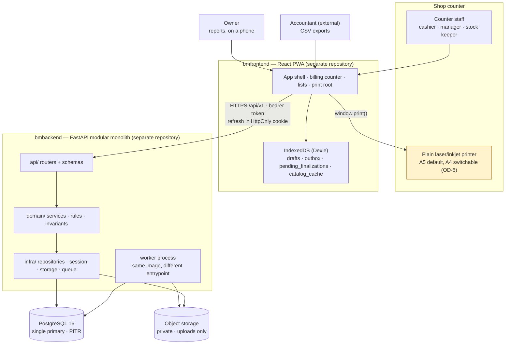
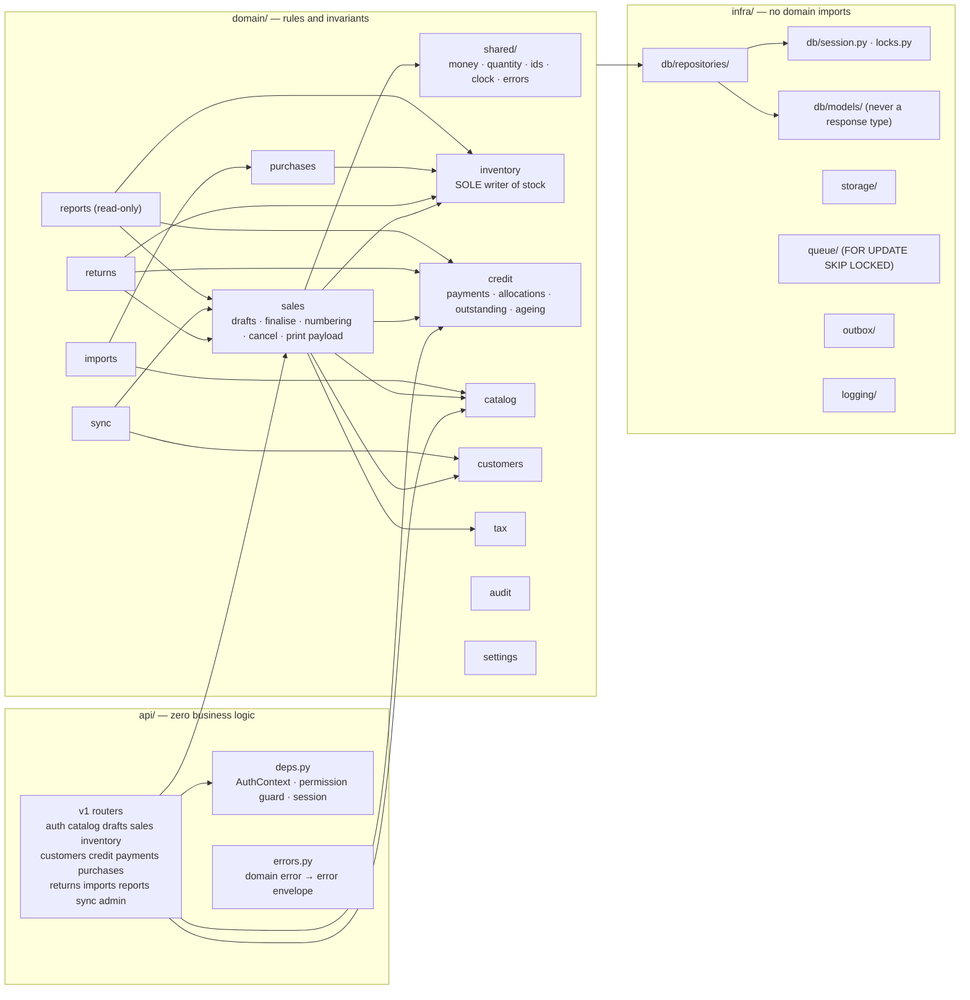
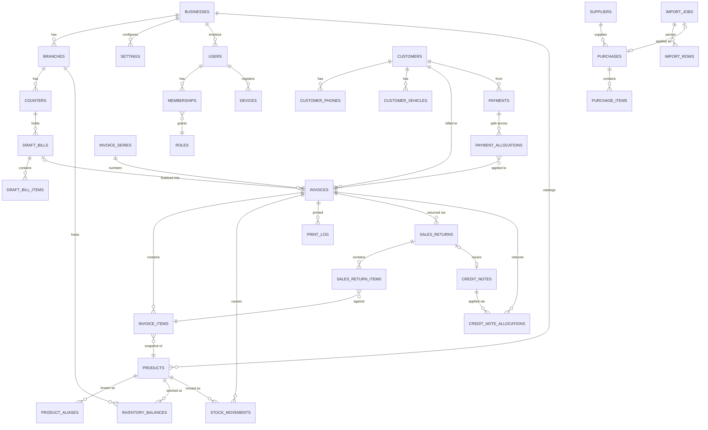
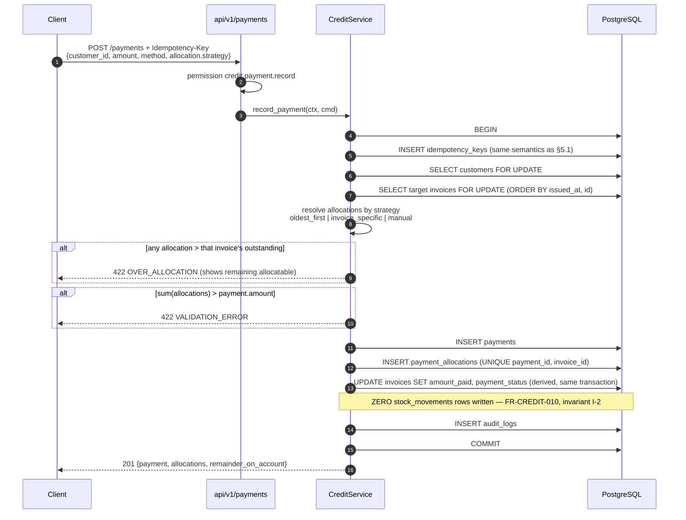
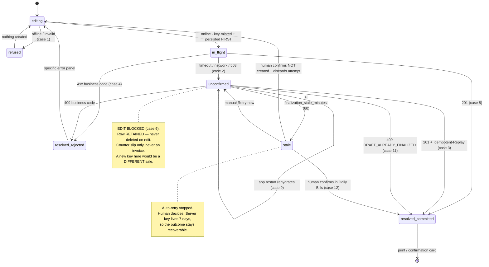
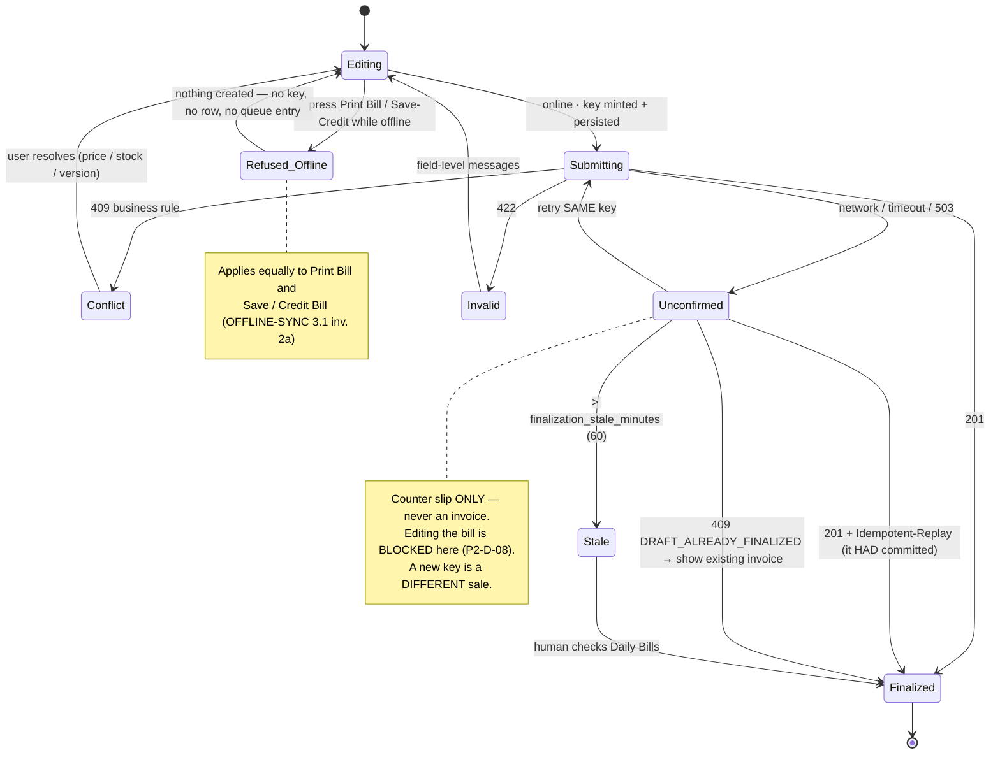
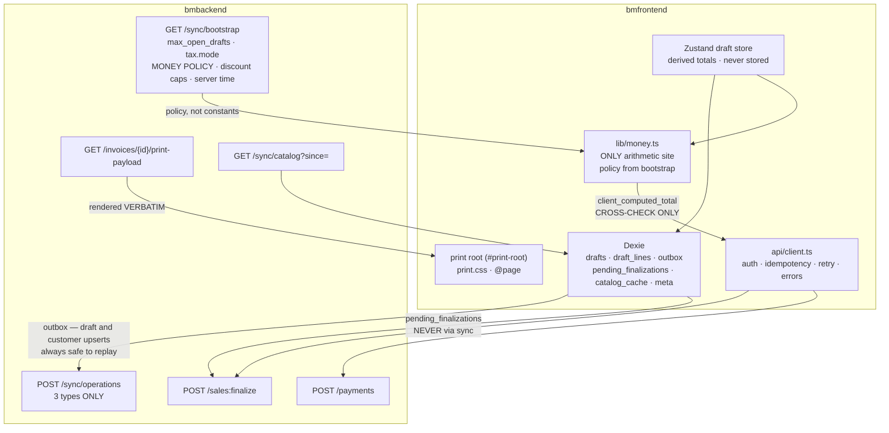
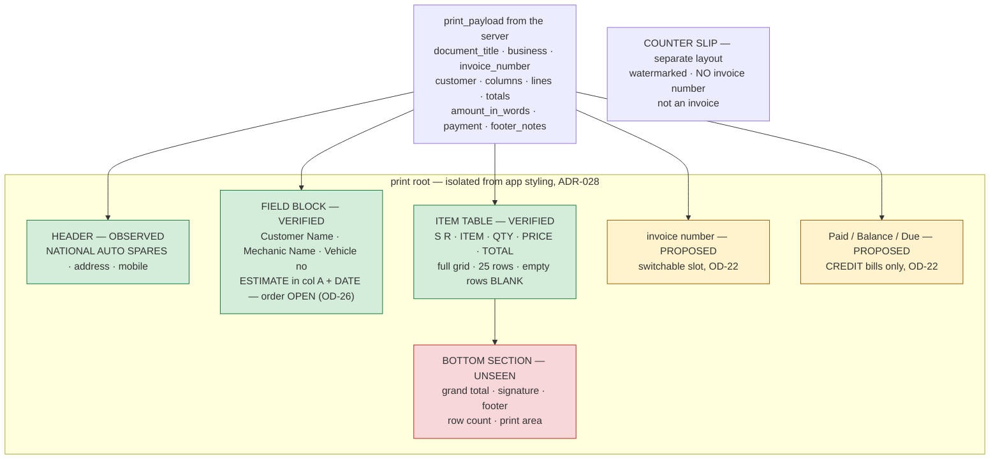
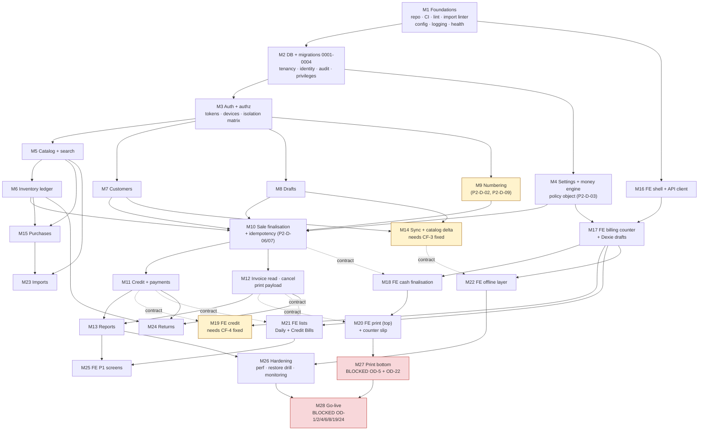

# Phase 2 — Implementation Blueprint

| Field | Value |
|---|---|
| Status | **Living Phase 2 record.** Proposed target design for Phase 3 |
| Purpose | The target architecture, module boundaries, database design, API contracts, integration, transaction/idempotency design, security and reliability mechanisms, migration strategy, test strategy and operational design — in one place a Phase 3 session can build from |
| Relationship to Phase 1 | **This document does not replace the Phase 1 specifications.** `ARCHITECTURE.md`, `DATA-MODEL.md`, `API-SPECIFICATION.md`, `SECURITY.md` and `OFFLINE-SYNCHRONIZATION.md` remain authoritative. This blueprint assembles them into a build order and adds only what Phase 2 found missing |
| Implementation performed | **None.** Every code block is **illustrative pseudocode or a proposed contract**, clearly labelled. No application file was created |
| Diagram syntax | Mermaid, renderable in GitHub/VS Code |

> **Distinguish proposed from implemented.** Nothing in this document exists. Every "the system does
> X" should be read as "the system is specified to do X in Phase 3". No test referenced here has been
> written or executed.

---

## 1. Source-of-truth hierarchy

Phase 1 implied a hierarchy but never stated one. This is proposed as `P2-D-04` and must be followed
whenever two documents disagree.

```
1. OWNER-DECISIONS.md          — all business decisions (what the owner decided, and its status)
2. PRD.md (backend)            — business rules, requirement IDs, priorities, acceptance criteria
   + bmfrontend/docs/PRD.md    — client requirements (same shared IDs)
3. API-SPECIFICATION.md        — the HTTP contract and error registry  (wins over API-INTEGRATION.md)
   DATA-MODEL.md               — schema, constraints, canonical identifier vocabularies (§3.14)
   OFFLINE-SYNCHRONIZATION.md  — the sync protocol
   SECURITY.md                 — authz enforcement, privileges, upload rules
4. ARCHITECTURE.md (both)      — module boundaries, transactions, locking
5. DECISIONS.md (both)         — ADR rationale; a `proposed` ADR never outranks a PRD requirement
6. TRACEABILITY.md             — the single matrix; derived, so it yields to its sources
7. TESTING-STRATEGY.md (both)  — derived from requirements
8. CLAUDE.md (both)            — session RULES, not specifications; must agree with the above
9. README.md (both)            — orientation only
—  bm/README.md               — NON-AUTHORITATIVE by its own header (ADR-021)
—  PHASE-1-CLOSURE-REPORT*    — immutable historical snapshots; disposable evidence
```

**And above all of it:** *when documentation and code disagree, the code is the fact* — read the code,
then fix the documentation and say that you did (both `CLAUDE.md` files). From Phase 3 onward this
rule becomes active for the first time.

---

## 2. System context



**Boundaries.** The two repositories communicate **only** through the documented HTTP API. No shared
database, no shared package, no shared runtime. The printed bill is the one place where a physical
dependency (OD-6, the real printer and paper) gates acceptance.

---

## 3. Component boundaries



**Enforced rules** (CI import linter, a merge blocker from milestone M1 — `P2-D-05`):

1. `api` may import `domain`; it contains **no** money arithmetic, **no** stock decision, and no
   permission logic beyond *declaring* the required permission.
2. `domain` modules call each other **only** through `domain/<other>/service.py` — never another
   module's repository or ORM model.
3. `infra` must **not** import `domain`.
4. ORM models stay inside repositories and are never a response type.
5. **Table ownership is exclusive.** `inventory` is the only writer of `inventory_balances` and
   `stock_movements`; `sales` owns invoices and drafts; `credit` owns payments and allocations.

---

## 4. Database design

### 4.1 Core relationships



Full column, constraint and index definitions remain in [`DATA-MODEL.md`](DATA-MODEL.md) §3 and are
**not duplicated here**. This blueprint adds only the Phase 2 findings below.

### 4.2 Phase 2 additions and corrections to the schema

All are small; **no structural redesign is proposed.**

| # | Change | Reason | Source |
|---|---|---|---|
| S-1 | Promote **`NFR-DATA-002b`** (`invoices.subtotal` = Σ `invoice_items.line_total`) into `PRD.md §7.4` and add a traced invariant test | Orphan invariant; without it a bill can satisfy `ck_invoices__total` yet disagree with its own lines | Audit **CF-9** |
| S-2 | Add `ix_invoices__customer_outstanding` to the `DATA-MODEL.md §5` index summary | Proposed in §3.9 for Credit Bills but missing from the index list; would be lost during migration authoring | Investigation **D-9** |
| S-3 | Implement the `settings` scope uniqueness as a **unique index on the `coalesce(...)` expression**, not a table constraint | Postgres requires an expression index for nullable-column uniqueness of this shape | Investigation **D-4** |
| S-4 | Add an invariant **test** (not a `CHECK`) that a non-cancelled `is_credit = false` invoice has `payment_status = 'paid'` | A cancelled cash invoice legitimately has `payment_status='cancelled'`, so a constraint would be wrong | Investigation **D-3** |
| S-5 | Specify **lazy creation of the financial-year `invoice_series` row** inside the finalisation transaction: `INSERT … ON CONFLICT DO NOTHING` then `SELECT … FOR UPDATE` | Nothing specifies who creates the row on 1 April; the first sale of a new FY would otherwise fail | `P2-D-09` |
| S-6 | Reorder `DATA-MODEL.md §3.12–3.14`; move `jobs`, `outbox_events`, `notifications` under `§3.12` | Navigational defect in the authoritative schema doc | Audit **CF-10** |
| S-7 | Verify the `invoice_items` grant is **exactly** `UPDATE (returned_quantity)` | It is the only mutable column on an append-only table | Investigation **D-1** |
| S-8 | Add a write-path test that inserting a `product_aliases` row refreshes the parent `products.search_text` | `search_text` is app-maintained by design, which creates a write-path obligation | Investigation **D-7** |

### 4.3 Migration ordering

`DATA-MODEL.md §6.1`'s 0001–0016 order was verified against every FK dependency and is **correct as
written**. Phase 3 should follow it exactly, inserting the S-1…S-8 items into the migration that
creates the affected object (not as later patches).

**Rollback limitations to accept up front:** every migration ships a reviewed, CI-tested
`downgrade()`, but for any table holding live financial data the **first** rollback option is always
"roll back the app, leave the schema" — which is only possible because expand→migrate→contract is
mandatory. Destructive downgrades on financial tables are a PITR restore, not an `alembic downgrade`.
In Phase 3 this risk is near zero because there is no live data until go-live.

---

## 5. Transaction and idempotency design

### 5.1 Sale finalisation — the critical path

```mermaid
sequenceDiagram
    autonumber
    participant C as Client (billing counter)
    participant D as IndexedDB
    participant A as api/v1/sales
    participant S as SalesService
    participant I as InventoryService
    participant N as numbering
    participant Cr as CreditService
    participant DB as PostgreSQL

    C->>D: write pending_finalizations{draft_id, key, payload_hash}
    Note over C,D: key minted ONCE per intent, persisted BEFORE the first send
    C->>A: POST /sales:finalize + Idempotency-Key
    A->>A: auth → permission billing.sale.finalize → schema (extra=forbid)
    A->>S: finalize_sale(ctx, cmd)

    S->>DB: BEGIN (READ COMMITTED)
    S->>DB: INSERT idempotency_keys (UNIQUE business,endpoint,key)
    alt key exists & completed & same fingerprint
        DB-->>S: conflict
        S-->>C: 201 + stored response + Idempotent-Replay: true
    else key exists & different fingerprint
        S-->>C: 409 IDEMPOTENCY_KEY_REUSE
    else key exists & in progress
        S-->>C: 409 IDEMPOTENT_REQUEST_IN_PROGRESS + retry_after_ms
    else new key
        Note over S,DB: no inventory lock held yet — P2-D-06
        S->>DB: SELECT draft FOR UPDATE; assert finalizable
        S->>DB: resolve live prices + active check
        S->>S: assert_prices_acceptable → else 409 PRICE_CHANGED
        S->>S: money.compute_invoice_totals(policy) → 422 TOTAL_MISMATCH on cross-check
        S->>I: lock_and_check(branch, lines)
        I->>DB: SELECT inventory_balances FOR UPDATE (ORDER BY product_id ASC)
        alt shortfall & no authorised override
            S-->>C: 409 INSUFFICIENT_STOCK (per-line requested/available)
        end
        S->>N: allocate(branch, series, now)
        N->>DB: INSERT invoice_series ON CONFLICT DO NOTHING
        N->>DB: SELECT next_number FOR UPDATE; UPDATE next_number+1
        S->>DB: INSERT invoices + invoice_items (immutable snapshots)
        S->>I: apply_movements(...)
        I->>DB: INSERT stock_movements + UPDATE inventory_balances
        opt payment supplied
            S->>Cr: record_payment(...)
            Cr->>DB: INSERT payments + payment_allocations
            Cr->>DB: UPDATE invoices(amount_paid, payment_status)
        end
        S->>DB: UPDATE draft_bills SET status='finalized', invoice_id=...
        S->>DB: INSERT audit_logs
        S->>DB: INSERT outbox_events
        S->>DB: UPDATE idempotency_keys SET status='completed', response_body=...
        S->>DB: COMMIT
        S-->>C: 201 {invoice, print_payload, warnings}
    end

    C->>D: delete pending_finalizations (resolved)
    C->>C: window.print() — AFTER finalisation only
```

**Non-negotiable properties of this sequence.**

| # | Property | Why |
|---|---|---|
| 1 | **Everything between BEGIN and COMMIT is one transaction.** Partial success is impossible | FR-SALE-001 |
| 2 | **The idempotency row is inserted inside the transaction**, so a rollback leaves the key reusable | Makes client retry safe (E-2) |
| 3 | **The key is claimed before any inventory lock is taken** | A duplicate submit must not block a real sale on the same product for `lock_timeout` — `P2-D-06` |
| 4 | **Lock order is fixed:** `inventory_balances` (ascending `product_id`) → `invoice_series` → `customers` → `invoices` | Makes deadlock structurally impossible (ADR-008) |
| 5 | **The number is allocated after stock is verified**, so the hot series row is held for the minimum time and a stock failure consumes no number | FR-SALE-004 |
| 6 | **No HTTP call, file I/O or job execution inside the transaction** — side effects go to `outbox_events` | ARCHITECTURE §5 rule 3 |
| 7 | **Printing happens only after a successful commit** | F-05; printing is not finalisation |
| 8 | `client_computed_total` is a **cross-check**, never a value to trust | FR-SALE-003 |

### 5.2 Idempotency and canonical fingerprinting — the complete specification (`P2-D-06`, `P2-D-07`)

> **No exactly-once delivery is claimed.** Across a network, delivery is **at-least-once** and some
> outcomes are **genuinely unknown** to the client. What this design guarantees is **no duplicate
> business effect**: a repeated request either does the work once or returns the outcome of the work
> already done, and the single residual unknown case is escalated to a human (§5.4.5) rather than
> guessed.

#### 5.2.1 When the key is claimed, and why before inventory

The key row is inserted as the **first write** of the finalisation transaction, **before** any
inventory lock (`P2-D-06`). This is a correctness constraint, not an optimisation:

| Order | Consequence of a duplicate submit |
|---|---|
| **Claim key → lock stock** ✅ | The duplicate fails in microseconds with `409 IDEMPOTENT_REQUEST_IN_PROGRESS`, holding **no** business locks |
| Lock stock → claim key ❌ | The duplicate **blocks a genuine sale of the same product** for up to `lock_timeout` (3 s) before discovering it is a replay |

At a counter with two tills selling the same fast-moving part, that is the difference between a
double-click being invisible and it stalling the other till. A second reason: the unique constraint
is the serialisation point for concurrent same-key requests (§5.2.2), so making it the first write
keeps that role unambiguous.

**The key is consumed only if the work commits.** Because the insert is inside the business
transaction, a rolled-back attempt leaves the key **reusable** — which is precisely what makes client
retry safe after a failure.

#### 5.2.2 Concurrent requests with the same key

`uq_idempotency__scope (business_id, endpoint, key)` is the serialisation point. Behaviour:

| Situation | Response | HTTP |
|---|---|---|
| New key | Process; store `response_status` + `response_body` on commit | `201` |
| Same key, same fingerprint, `completed` | **Stored response**, byte-for-byte, + `Idempotent-Replay: true` | original status |
| Same key, same fingerprint, `in_progress` | `IDEMPOTENT_REQUEST_IN_PROGRESS` + `retry_after_ms` | `409` |
| Same key, **different** fingerprint | `IDEMPOTENCY_KEY_REUSE` + `conflicting_fingerprint` — **never silently accepted** | `409` |

Two truly simultaneous inserts: one wins the unique constraint, the loser's insert raises a
violation, and the loser then **re-reads** the row to decide between the three replay cases above.
The loser must **not** hold inventory locks while doing so.

#### 5.2.3 Canonicalisation — normative rule

Phase 1 specified "SHA-256 of the canonicalised body" without defining canonicalisation. Left
undefined, a client that reserialises its own request differently between attempts breaks **its own
retry** in the one path designed to make a lost response safe.

```text
canonical(body) =
  1. Drop every key whose value is JSON null.                     (omitted ≡ explicit null)
  2. Sort object keys lexicographically, recursively.
  3. Normalise every money / quantity / percent string to its Decimal value, then
     re-render at the field's DECLARED scale.                      ("2500.0" → "2500.00")
  4. Preserve array order exactly.                                 (line order is significant)
  5. Lower-case every UUID; reject non-canonical UUID forms at validation, not here.
  6. Normalise timestamps to RFC 3339 UTC with second precision; DROP client-only
     diagnostic timestamps entirely (see the exclusion list).
  7. Enum values compare as exact ASCII strings — no case folding, no synonyms.
  8. Booleans and integers compare by value, not by spelling (`1` ≠ `true`).
  9. Exclude the fields listed in §5.2.4.
 10. Serialise with no insignificant whitespace, UTF-8, then SHA-256.
```

**Rule 3 is the load-bearing one.** Worked example on `POST /sales:finalize`:

| Attempt 1 sends | Attempt 2 sends | Canonical form | Same intent? | Outcome |
|---|---|---|---|---|
| `"unit_price": "1250.0000"` | `"unit_price": "1250.00"` | both → `"1250.0000"` (scale 4) | ✅ yes | **Replay** — stored response returned |
| `"quantity": "2"` | `"quantity": "2.000"` | both → `"2.000"` (scale 3) | ✅ yes | **Replay** |
| `"client_computed_total": "2500.00"` | `"client_computed_total": "2500.0"` | both → `"2500.00"` (scale 2) | ✅ yes | **Replay** |
| `"discount_percent": "0.000"` | *field omitted* | rule 1 + default | ✅ yes | **Replay** |
| `"quantity": "2.000"` | `"quantity": "3.000"` | differ | ❌ **no** | `409 IDEMPOTENCY_KEY_REUSE` |
| lines `[A, B]` | lines `[B, A]` | differ (rule 4) | ❌ **no** | `409 IDEMPOTENCY_KEY_REUSE` |

**Rule 3 depends on declared scale, not on the money policy.** Scale is fixed by the schema
(amounts 2, unit prices 4, quantities 3, percents 3 — `DATA-MODEL.md §1`) and is **independent of
[OD-7](OWNER-DECISIONS.md#od-7)**, which governs *rounding behaviour*, not field width. Canonicalisation
therefore does **not** assume any unapproved policy value: it re-renders at the declared scale and
performs **no rounding** — a value whose precision exceeds the declared scale is rejected at
validation with `422`, never silently rounded here.

#### 5.2.4 Fields included and excluded

| Treatment | Fields |
|---|---|
| **Excluded** — must not affect the fingerprint | `Idempotency-Key` itself · `X-Request-Id` (changes every attempt by design) · **all** headers · `client_created_at`, `client_updated_at` and any `client_*` diagnostic timestamp (FR-OFFLINE-007 — stored for diagnostics, never business-significant) · `draft_version` (a staleness check, not part of the sale's identity) |
| **Included** — part of the sale's identity | `draft_id` · `counter_id` · `sale_type` · `customer` (mode + `customer_id`) · every `header` field · the full `lines` array in order · `invoice_discount` · `payment` · `client_computed_total` · `accept_price_changes` · `oversell_override` |

**Why `draft_version` is excluded.** A retry after the server bumped the draft's version is the
*same* sale intent; including it would turn a legitimate retry into `IDEMPOTENCY_KEY_REUSE`. Staleness
is still enforced — the server compares `draft_version` independently and returns
`409 DRAFT_VERSION_CONFLICT` — it simply does not participate in *identity*.

**Why `client_computed_total` is included.** It is the user's own view of the bill. If it changed, the
bill changed.

#### 5.2.5 Recovering a stored outcome; representing failures

| Stored `status` | What is replayed | Client reads it as |
|---|---|---|
| `completed` (2xx) | `response_status` + `response_body` verbatim, + `Idempotent-Replay: true` | **Resolved: committed** (§5.4 case 3) |
| `in_progress` | Nothing — `409 IDEMPOTENT_REQUEST_IN_PROGRESS` + `retry_after_ms` | Keep retrying with backoff |
| *row absent* | Nothing | Either never arrived **or** pruned — §5.4 case 12, human arbitration |

**Business rejections are deliberately not stored as a replayable outcome.** A `409 INSUFFICIENT_STOCK`
rolls the transaction back, so the key is **not** consumed and the same key may be reused once the
user fixes the quantity — which is the correct behaviour: it is still the same sale intent. Only
**committed** outcomes are replayable. `IDEMPOTENT_REQUEST_IN_PROGRESS` and `SERVICE_UNAVAILABLE`
carry `retryable: true` in the error envelope; business conflicts carry `retryable: false`.

#### 5.2.6 Retention versus late retries

| Window | Value |
|---|---|
| Server key retention | `idempotency.retention_days`, default **7 days** |
| Client auto-retry stops | `sync.finalization_stale_minutes`, default **60 minutes** |
| Margin | **~168×** |

A stored outcome therefore always outlives the client's automatic retry window by a wide margin, and
remains available for six further days for human arbitration. **Pruning can never strand an
automatic retry.** The only path to a pruned key is a client left closed for over a week — handled as
§5.4 case 12.

#### 5.2.7 Client-side identity preservation

- The key is minted **once per intent** and **persisted to IndexedDB before the first request is
  sent** — if the browser dies between send and receive, the key must already be on disk or the
  retry becomes a duplicate sale (E-2).
- `pending_finalizations` stores the key **and** `canonical_hash` **and** `request_body`, so a retry
  resends a byte-reproducible request rather than re-deriving one from possibly-changed draft state.
- **A new key is minted only when the intent genuinely changes**, and §5.4.4 blocks editing while an
  attempt is unresolved — so the "same key, different request" case is unreachable through the UI.
  The server-side fingerprint check is the **backstop**, not the primary control.
- `X-Request-Id` changes per attempt; `Idempotency-Key` does not. Confusing the two is *"the single
  most likely way to create a duplicate invoice"* (`API-INTEGRATION.md §3.2`) and is asserted
  directly by test.

#### 5.2.8 Transaction and uniqueness requirements

1. `uq_idempotency__scope (business_id, endpoint, key)` — **UNIQUE**, non-deferrable.
2. The key row is `INSERT`ed inside the business transaction, as its **first** write.
3. `response_body` and `response_status` are written in the **same** transaction that commits the
   business effect — so a stored response can never describe work that did not commit.
4. Key scope is **per business and per endpoint**: the same key value on `/payments` and
   `/sales:finalize` are different keys.
5. Keys must be UUIDs; a missing required key is `422 VALIDATION_ERROR` with
   `fields: {"Idempotency-Key": "required"}`.
6. Required on: `POST /sales:finalize`, `/payments`, `/payments/{id}:reverse`, `/returns`,
   `/purchases/{id}:confirm`, `/inventory/adjustments`, `/invoices/{id}:cancel`,
   `/imports/{id}:apply`. `PUT /drafts/{id}` and `PUT /customers/{id}` need none — the
   client-generated id makes them naturally idempotent.

#### 5.2.9 Acceptance criteria

| # | Criterion | Layer |
|---|---|---|
| AC-IDEM-1 | Same key + same payload twice → one invoice; second response **identical** + `Idempotent-Replay: true` | BE API |
| AC-IDEM-2 | Same key + different payload → `409 IDEMPOTENCY_KEY_REUSE`, no second effect | BE API |
| AC-IDEM-3 | Concurrent same-key requests → **exactly one** invoice; the loser gets the stored response or `IDEMPOTENT_REQUEST_IN_PROGRESS` | BE concurrency |
| AC-IDEM-4 | A duplicate submit returns `IDEMPOTENT_REQUEST_IN_PROGRESS` **without** delaying a concurrent sale of the same product (`P2-D-06`) | BE concurrency |
| AC-IDEM-5 | Rolled-back attempt → the key is **not** consumed and the same key succeeds afterwards | BE integration |
| AC-IDEM-6 | **Shared fixture list**: every equivalent pair replays; every non-equivalent pair conflicts — the *same* fixture file drives both suites | BE + FE |
| AC-IDEM-7 | `client_created_at` / `X-Request-Id` / `draft_version` differing between attempts still **replays** | BE API |
| AC-IDEM-8 | Missing required key → `422` | BE API |
| AC-IDEM-9 | A value exceeding its declared scale → `422`, never silently rounded in canonicalisation | BE unit |

**Cross-repository fixture rule.** The equivalent/non-equivalent payload pairs live in **one** fixture
file mirrored into both repositories — the pattern already established for part-number normalisation
fixtures (`../../bmfrontend/docs/ARCHITECTURE.md §8.3`), which is this project's chosen way of holding
an unavoidable duplication honestly.

### 5.3 Payment allocation



**Properties.** Remainder becomes on-account customer credit (FR-PAY-003) and is allocatable later.
`payment_status` is written **only** here and in finalisation/cancellation, inside the same
transaction as the allocation rows, and column grants prevent any other write path. A wrong payment
is corrected by a **`reversal` payment referencing the original** — never edited or deleted. Payments
are locked in a deterministic order (`issued_at, id`) so two concurrent collections on one customer
cannot lose an update.

### 5.4 Sale-finalisation recovery — the complete design (`P2-D-08`)

**This is a Phase 3 blocking design requirement for M18 (cash finalisation) and M22 (offline
layer).** It resolves the mechanism conflict between `OFFLINE-SYNCHRONIZATION.md §3.1` invariant 4
(*"the UI must not allow [a new key for an edited bill] while one is unconfirmed"*) and
`API-INTEGRATION.md §5`'s illustrative `onDraftEdited()`, which **deletes** the
`pending_finalizations` row — discarding the idempotency key of a sale that may already have
committed.

#### 5.4.1 What is persisted, and where

Two client records, in **separate Dexie stores** (ADR-010), plus the server's own record.

```ts
// PROPOSED — db/pendingFinalizations.ts (illustrative; not implementation)
interface PendingFinalization {
  draft_id: string;             // PK — one in-flight intent per draft, at most
  idempotency_key: string;      // minted ONCE per intent; NEVER regenerated for this row
  canonical_hash: string;       // SHA-256 of canonical(request body) — §5.2
  request_body: unknown;        // the exact body to resend, byte-reproducible
  started_at: string;           // server-clock-adjusted
  attempts: number;
  last_error_code: string | null;
  state: 'in_flight' | 'unconfirmed' | 'stale';
  resolution: null | { kind: 'committed'; invoice_id: string }
                   | { kind: 'rejected'; code: string }
                   | { kind: 'abandoned_by_user'; at: string };
}
```

| Store | Lifetime | Deleted when |
|---|---|---|
| `drafts` / `draft_lines` | Until finalised or discarded | Draft finalises or the user discards it |
| **`pending_finalizations`** | **From immediately before the first attempt until the outcome is *known*** | **Only on resolution — never on an edit, a reload, or a timeout** |
| `idempotency_keys` (server) | `idempotency.retention_days`, default **7** | Pruned by a worker job |

**The retention arithmetic matters and it is sound:** auto-retry stops at
`sync.finalization_stale_minutes` (default **60 minutes**), and the server keeps keys for **7 days**
— so a stored outcome is always still recoverable while the client could still be retrying, and for
six further days by a human.

#### 5.4.2 The twelve required cases

| # | Case | Client state | Server effect | Retry safe? | Behaviour |
|---|---|---|---|---|---|
| **1** | **Request never sent** (offline, or local validation failed) | `editing` | **None** | n/a | **Nothing is created** — no key, no `pending_finalizations` row, no queued operation. The bill stays an editable draft. Applies identically to `Print Bill` and `Save / Credit Bill` (invariants 2, 2a) |
| **2** | **Sent, client timed out** (30 s) | `in_flight` → `unconfirmed` | **Unknown** | ✅ **with the same key** | Row retained. Loud not-confirmed UI. Auto-retry with backoff. **Counter slip only — never an invoice** |
| **3** | **Server committed, response lost** | `unconfirmed` | **Complete** — invoice, movements, payment all exist | ✅ **with the same key** | Retry returns the **stored response** + `Idempotent-Replay: true`. Resolve as `committed`, show the invoice, offer Reprint. **Exactly one invoice exists** |
| **4** | **Server definitively rejected** (any 4xx with a business `code`) | `in_flight` → resolved | **None** (transaction rolled back; the key was **not** consumed) | n/a — do not retry | Clear the row, resolve as `rejected`, render the specific panel (`INSUFFICIENT_STOCK`, `PRICE_CHANGED`, …). The bill returns to `editing` |
| **5** | **Success response received** (`201`) | resolved | **Complete** | n/a | Clear the row, store the invoice, then open the print dialog (cash) or the confirmation card (credit) |
| **6** | **Draft edited while the outcome is uncertain** | `unconfirmed` | **Unknown** | — | ⛔ **Editing is BLOCKED.** The bill renders read-only with `Retry now` · `Print counter slip` · `Check Daily Bills` · `Discard this attempt`. See §5.4.4 |
| **7** | **Same key retried with the same canonical request** | `unconfirmed` | Unknown → becomes known | ✅ | Server: completed → stored response + `Idempotent-Replay: true`; in-progress → `409 IDEMPOTENT_REQUEST_IN_PROGRESS` + `retry_after_ms`; absent → processes fresh. All three resolve the row |
| **8** | **Same key retried with a *different* canonical request** | — | — | ❌ **unsafe** | `409 IDEMPOTENCY_KEY_REUSE`. **Treated as a client bug**, reported to error tracking. §5.4.4 makes this unreachable through the UI; the server check is the backstop |
| **9** | **Application restarts while uncertain** | `unconfirmed` (from IndexedDB) | Unknown | ✅ | Drafts load from Dexie **before** auth (`API-INTEGRATION.md §9`). The row is rehydrated and the not-confirmed UI reappears. `beforeunload` warns first (FE-E-5) |
| **10** | **Network reconnects after the original request** | `unconfirmed` | Unknown | ✅ | The `online` event triggers a retry of the **same** key. One attempt at a time per `draft_id` |
| **11** | **The invoice had already committed** (detected by any route) | — | Complete | n/a | Three signals converge on the same resolution: stored response + `Idempotent-Replay`, or `409 DRAFT_ALREADY_FINALIZED` carrying the invoice, or the user finding it in Daily Bills. **No retry affordance is ever offered on `DRAFT_ALREADY_FINALIZED`** |
| **12** | **Recovery finds no server-side record** (key pruned, or never arrived) | `stale` | **Genuinely unknown** | ⚠️ **not automatically** | A fresh key would be a *new sale*. **Requires an explicit human decision** — see §5.4.5 |

#### 5.4.3 State machine



#### 5.4.4 Case 6 in detail — editing while uncertain

`onDraftEdited()` must **never** delete the `pending_finalizations` row. The correct rule:

```ts
// PROPOSED — illustrative; replaces the snippet in API-INTEGRATION.md §5
function canEditDraft(draft: Draft): boolean {
  const p = pendingFinalizations.get(draft.id);
  return !p || p.resolution !== null;        // editable only when resolved or absent
}

function onDraftEdited(draft: Draft) {
  const p = pendingFinalizations.get(draft.id);
  if (p && p.resolution === null) throw new Error('unreachable: UI must block editing');
  if (p && p.resolution !== null) pendingFinalizations.delete(draft.id);  // clear on RESOLUTION
  // the next finalisation of this (now changed) bill mints a NEW key — a new intent
}
```

**Why blocking rather than allowing-and-reconciling.** If editing were allowed, the system would hold
a key bound to request *A* while the user has produced request *B*. Resending *A* could commit a bill
the user no longer wants; resending *B* under *A*'s key is `IDEMPOTENCY_KEY_REUSE` (case 8); minting
a new key for *B* risks **two invoices** if *A* had in fact committed. Blocking is the only option
that keeps the recovery identity intact, and it is consistent with the existing design — the
unconfirmed tab already *cannot be closed* without an explicit warning
(`UI-UX-SPECIFICATION.md §4.9`); it now also cannot be edited.

**The user is never trapped.** `Discard this attempt` is available: it requires the user to confirm
they have checked Daily Bills, records an `abandoned_by_user` resolution with a timestamp, keeps the
abandoned key in an audit-visible local list, and only then unlocks editing. The subsequent
finalisation mints a **new** key, which is correct because it is genuinely a new intent.

#### 5.4.5 Case 12 — no server-side record

The honest position: **exactly-once delivery across a network is impossible.** What the design
guarantees is **no duplicate business effect**, via idempotency + a single transaction + explicit
human arbitration in the one residual case.

If a retry finds no `idempotency_keys` row, two mutually exclusive situations are indistinguishable
from the client: the request never reached the server, or it committed and the key was pruned
(≥ 7 days later). The system **must not guess**. Required behaviour:

1. Stop automatic retry (already enforced at the 60-minute threshold).
2. Show: *"We cannot confirm whether bill N was saved. Please check Daily Bills for
   <customer> / <amount> / <date> before completing it again."*
3. Offer a **pre-filtered Daily Bills search** on the draft's customer, total and date window.
4. The human then selects `It was saved — link it` (resolve `committed`, attach the invoice) or
   `It was not saved — let me re-bill` (resolve `abandoned_by_user`, unlock editing, new key next
   time).
5. Record the decision in the audit log via the next operation's context.

**Server-side support required (Phase 3 task).** The 60-minute client threshold is well inside the
7-day key retention, so this case is reachable in practice only after a long outage or a client left
closed for over a week. The `invoices.idempotency_key` column already exists "for forensic tracing"
(`DATA-MODEL.md §3.8`) — Phase 3 should expose it through the existing
`GET /invoices` filter set so the lookup is exact rather than heuristic. Recorded as Phase 3 task
**T3-01** in [`PHASE-2-IMPLEMENTATION-PLAN.md`](PHASE-2-IMPLEMENTATION-PLAN.md) §1.1.

#### 5.4.6 Forbidden transitions

| Forbidden | Why |
|---|---|
| `unconfirmed` → `editing` without an explicit resolution | Discards the recovery identity (case 6) |
| Deleting a `pending_finalizations` row on an edit, reload or timeout | The exact defect `P2-D-08` fixes |
| Minting a new key while a row is unresolved | A new key is a **new sale** — duplicate-invoice path |
| Printing an **invoice** in `unconfirmed` or `stale` | No invoice number exists client-side; only the server allocates one. Counter slip only |
| Creating a `pending_finalizations` row while offline | `pending_finalizations` is online-only by construction (invariant 1) |
| Draining `pending_finalizations` through `/sync/operations` | The sync registry has no finalisation type (invariant 3, AC-OFF-8) |
| Auto-resolving `stale` as "not created" | Case 12 — unknowable without a human |

#### 5.4.7 Acceptance criteria

| # | Criterion | Layer |
|---|---|---|
| AC-REC-1 | Dropped response, then retry with the same key → **exactly one** invoice, one set of movements, one payment | BE + FE E2E |
| AC-REC-2 | The key is present in Dexie **before** the first request resolves | FE unit |
| AC-REC-3 | Three retries send **one** `Idempotency-Key` and **three** distinct `X-Request-Id` | FE unit |
| AC-REC-4 | An edit attempt while `unconfirmed` is **blocked**; the row survives with its key and hash unchanged | FE unit |
| AC-REC-5 | Browser force-close in `unconfirmed`, then reopen → state rehydrated, same key, auto-retry resumes | FE E2E |
| AC-REC-6 | After the stale threshold, auto-retry stops and the Daily Bills prompt appears | FE E2E |
| AC-REC-7 | `Discard this attempt` requires confirmation, records `abandoned_by_user`, and only then permits editing | FE unit |
| AC-REC-8 | `409 DRAFT_ALREADY_FINALIZED` renders the existing invoice with **no retry affordance** | FE unit |
| AC-REC-9 | A changed bill after a resolved attempt mints a **new** key | FE unit |
| AC-REC-10 | No code path creates a `pending_finalizations` row while offline | FE structural |
| AC-REC-11 | Case 12: with the key absent server-side, the client **never** auto-creates a second sale | FE E2E |

### 5.5 Failure and recovery paths — overview



**`P2-D-08` resolves a mechanism conflict here.** `OFFLINE-SYNCHRONIZATION.md §3.1` invariant 4 says
the UI must not allow a new key for an edited bill while one is unconfirmed; but
`API-INTEGRATION.md §5` shows `onDraftEdited()` **deleting** the `pending_finalizations` row — which
would discard the only record of a key that may already have created an invoice. Phase 3 must:

1. **Block editing** while a draft has an unresolved `pending_finalizations` row (per invariant 4),
   offering `Retry now` / `Print counter slip` / `Check Daily Bills`.
2. Clear the row **only on resolution** (201, a business 409, or an explicit human decision) — never
   as a side effect of a keystroke.
3. Cover it with a test: *edit attempt while unconfirmed → blocked, row intact, key unchanged.*

---

## 6. API contracts

### 6.1 Status

The contract in [`API-SPECIFICATION.md`](API-SPECIFICATION.md) is **approved as the Phase 3 target
and is preserved unchanged**, except for the additive corrections below. It is not restated here.

### 6.2 Required additive corrections

| # | Change | Breaking? | Blocks |
|---|---|---|---|
| A-1 | Add `PRECONDITION_REQUIRED`, `SKIPPED_AFTER_EARLIER_FAILURE`, `CORRUPT_VERSION`, `DRAFT_ALREADY_CANCELLED` to the `§4.2` registry; add `428` to the `§4.1` status table; mirror into `API-INTEGRATION.md §4` | **No** — codes are additive-only (§8) | **The sync client module.** The frontend's `ErrorCode` union is generated from this registry and must be handled exhaustively, so a required-but-unregistered code can never be handled |
| A-4 | Add `is_credit` to the documented `GET /invoices` query parameters | No | Credit Bills level 2 |
| A-5 | Add `invoice_id` to the documented `GET /payments` query parameters | No | FR-RPT-033 payment history |
| A-2 | Document *why* `OVER_ALLOCATION` is `422` (semantically invalid amount) rather than `409` | No | — |
| A-3 | State explicitly that `lines` in the finalise request are authoritative for the sale and `draft_version` is a staleness check; test that a mismatch is **not** silently reconciled | No | Finalisation |
| A-7 | Confirm a cashier may log a print event for an invoice they created (`reports.sales.read` is scoped to own-counter *reports*, not print logging) | No | Print logging |

### 6.3 Shared contract rules (both repositories)

| Dimension | Rule |
|---|---|
| Casing | `snake_case` in all JSON bodies and query parameters (ADR-012) |
| Money / quantity / percent | **JSON strings**, never numbers. Amounts 2 dp, unit prices 4 dp, quantities 3 dp, percentages 3 dp. Schema validation enforces scale → a 3-decimal amount is a `422`, never a silent round |
| Arithmetic | **Server only.** Client arithmetic confined to `lib/money.ts` with `decimal.js-light`; `parseFloat`/`Number()`/`+`/`-`/`*` on money elsewhere is a lint error |
| Dates / times | RFC 3339 with offset. **Server time is authoritative.** The client never derives a business date; `client_created_at` is diagnostics only |
| IDs | UUID. **Client-generatable** for `draft_bills`, `draft_bill_items`, `customers` — the client id **is** the server id, no remapping |
| Errors | One envelope on every non-2xx: `{code, message, details, request_id, retryable}`. Clients branch on `code`, never `message` |
| Warnings | Ride on a **successful** response; handled **permissively**. A new warning must never fail a committed sale |
| Types | Generated from OpenAPI, committed, CI regenerates against staging and **fails on a diff** |
| Pagination | Cursor-based; hard max 50 (search) / 200 (list). No unbounded query anywhere |
| Tenancy | Scope from the token only; `business_id` never accepted as a selector; cross-tenant → **`404`** |

---

## 7. Money engine design

**Proposed — illustrative signature only, not implementation code.** This is the `P2-D-03`
mechanism that lets the money module be built before OD-7 selects its values.

```python
# PROPOSED DESIGN SKETCH — domain/shared/money.py  (illustrative; not implementation)
#
# The POLICY is data, resolved from `settings`, published to the client via
# GET /sync/bootstrap.  The ALGORITHM is code.  OD-7 selects the policy values;
# it does not change the algorithm.

@dataclass(frozen=True)
class MoneyPolicy:
    amount_scale: int          # proposed 2
    unit_price_scale: int      # proposed 4
    quantity_scale: int        # proposed 3
    rounding: str              # 'half_up' | 'half_even' | 'down'   — proposed 'half_up'
    stage: str                 # 'line_then_sum' | 'sum_then_round' — proposed 'line_then_sum'
    round_grand_total_to_rupee: bool   # proposed False

def resolve_policy(settings) -> MoneyPolicy: ...          # settings override documented defaults
def line_total(qty, unit_price, discount_pct, discount_amt, p: MoneyPolicy) -> Decimal: ...
def invoice_totals(lines, invoice_discount, tax, p: MoneyPolicy) -> InvoiceTotals: ...
#   returns subtotal, discount_total, tax_total, rounding_adjustment, total
#   such that  total == subtotal - discount_total + tax_total + rounding_adjustment
#   (NFR-DATA-002, enforced additionally by ck_invoices__total)
```

#### 7.1 Evidence check — is the bootstrap premise actually supported?

**Verified in Phase 2 closure. Yes, with one honest qualification.**

| Claim | Evidence | Verdict |
|---|---|---|
| Bootstrap publishes the rounding policy | `API-SPECIFICATION.md §3.12`: *"settings relevant to the client (`max_open_drafts`, `tax.mode`, **rounding**, discount caps)"* | ✅ Supported |
| The client must not hardcode it | `../../bmfrontend/CLAUDE.md §5` rule 15 names **rounding policy** explicitly; `API-INTEGRATION.md §9, §14` repeat it | ✅ Supported |
| Rounding is already modelled as settings, not constants | `DATA-MODEL.md §3.1`: `sales.rounding_mode = line_half_up`, `sales.round_grand_total_to_rupee = false` | ✅ Supported |
| Bootstrap publishes a **structured policy object** | Not stated — `§3.12` says only "rounding" | ⚠️ **Not yet.** The *schema* below is the Phase 2 proposal that formalises what is already conceptually published |

So `P2-D-03`'s premise holds: the policy is already **configuration, published to the client**. What
Phase 2 adds is a **typed schema** for it, because "rounding" as a single unspecified word is exactly
how two divergent hardcoded constants get written on either side.

#### 7.2 Policy schema (proposed)

| Field | Type | Allowed values | Proposed default | Governed by |
|---|---|---|---|---|
| `policy_version` | int | ≥ 1 | `1` | engineering |
| `amount_scale` | int | `2` | `2` | OD-7 |
| `unit_price_scale` | int | `2`–`4` | `4` | OD-7 |
| `quantity_scale` | int | `0`–`3` | `3` | OD-7 |
| `percent_scale` | int | `3` | `3` | engineering |
| `rounding` | enum | `half_up` · `half_even` · `down` | `half_up` | **OD-7** |
| `stage` | enum | `line_then_sum` · `sum_then_round` | `line_then_sum` | **OD-7** |
| `round_grand_total_to_rupee` | bool | — | `false` | **OD-7** |

**Validation rules (fail startup, per the fail-fast principle):** scales must not exceed the
corresponding column scale in `DATA-MODEL.md §1`; `round_grand_total_to_rupee = true` requires
`amount_scale = 2`; an unknown enum value is a startup error, never a silent fallback.

#### 7.3 One authoritative definition, four consumers

```
docs/DATA-MODEL.md §3.1  settings keys  ──┐
                                          ├─► resolve_policy()  ── the ONE definition
code: documented defaults ────────────────┘            │
                                   ┌───────────────────┼───────────────────┐
                                   ▼                   ▼                   ▼
                    domain/shared/money.py   backend money tests    GET /sync/bootstrap
                      (authoritative)         (all combinations)            │
                                                                            ▼
                                                              lib/money.ts (preview only)
                                                              + frontend money tests
```

**How two divergent hardcoded constants are prevented** — four controls, each catching a different
mistake:

1. `resolve_policy()` is the only reader of the rounding settings keys; no service reads a raw row
   (`P2-D-10`).
2. The client receives the policy from bootstrap and a **structural test forbids hardcoding any
   business rule bootstrap provides** (`../../bmfrontend/docs/TESTING-STRATEGY.md §8` rule 10).
3. Both money suites are **parameterised over the policy**, so neither can encode a constant.
4. `client_computed_total` cross-checks at runtime → `422 TOTAL_MISMATCH` surfaces any residual
   divergence as a visible error rather than a silently wrong bill.

#### 7.4 Policy change must never reinterpret a historical invoice

This is the property that makes the whole approach safe, and it already exists in the design:

| Mechanism | Effect |
|---|---|
| `invoice_items` are **immutable snapshots** (FR-SALE-005, ADR-015) | A past invoice's line totals are stored, never recomputed |
| `ck_invoices__total` is a **database `CHECK`** | A stored invoice stays internally consistent regardless of the current policy |
| Reports read **stored** values | A policy change cannot retroactively alter a report |
| `print_payload` renders stored amounts verbatim (FR-PRINT-010) | A reprint of a 2026 bill shows 2026 figures |
| `['invoice', id]` / `['print-payload', id]` are `staleTime: Infinity` | *"a reprint can never show different figures from the original"* |

**Additionally required (Phase 3 task T3-03):** persist `policy_version` on the invoice at issue
time, alongside the existing `tax_config_version_id`. Without it, a disputed historical bill cannot
be explained — one can see *what* was computed but not *under which rule*. This is a one-column
additive change and must land with M10, before any invoice exists.

**A policy change is therefore forward-only**: it affects newly computed values, needs **no migration
on live financial data**, and `invoices.rounding_adjustment` already exists so enabling whole-rupee
rounding later requires no schema change.

#### 7.5 Why this unblocks work

With the policy as an explicit object: `GET /sync/bootstrap` already publishes it
(`API-SPECIFICATION.md §3.12`) and `bmfrontend/CLAUDE.md §5` rule 15 forbids hardcoding any business
rule bootstrap provides —

- `domain/shared/money.py`, its property tests, and the client's `lib/money.ts` can all be built now,
  **parameterised** by policy;
- what OD-7 blocks shrinks to selecting production values and freezing the *expected-value*
  assertions in the two money suites;
- a later policy change affects **newly computed** values only — issued invoices keep their snapshots
  and are never recomputed (FR-SALE-005, ADR-015), so **no migration on live financial data**.

**Rounding must be applied at every one of these points, under one policy, with a property test that
the chain reconciles:** line gross → line discount → `line_total` → `taxable_amount` → `tax_amount`
→ `subtotal` → invoice discount → `tax_total` → `rounding_adjustment` → `total` → allocation amounts
→ `amount_paid` → outstanding → ageing → report aggregates → CSV → **printed display** (OD-23
formatting renders and never changes a value).

**Proposed default policy** (TECHNICAL RECOMMENDATION — requires OD-7 approval): amounts 2 dp, unit
prices 4 dp, quantities 3 dp, `ROUND_HALF_UP`, **line-then-sum**, whole-rupee rounding **off**, no
domain exceptions. Rationale and worked examples in
[`PHASE-2-INVESTIGATION-REPORT.md §5.2`](PHASE-2-INVESTIGATION-REPORT.md).

---

## 8. Invoice numbering design

**Proposed — illustrative only.**

```python
# PROPOSED DESIGN SKETCH — domain/sales/numbering.py  (illustrative; not implementation)
def allocate(tx, ctx, series_code, now) -> AllocatedNumber:
    fy = financial_year_for(now, ctx.business.financial_year_start_month)

    # S-5 / P2-D-09 — lazy FY row creation, so the first sale after 1 April works
    tx.execute(insert(invoice_series)
               .values(business_id=ctx.business_id, branch_id=ctx.branch_id,
                       series_code=series_code, financial_year=fy, next_number=1, ...)
               .on_conflict_do_nothing(constraint="uq_invoice_series__scope"))

    row = tx.execute(select(invoice_series)
                     .where(scope_predicate(ctx, series_code, fy))
                     .with_for_update()).one()          # the serialisation point

    seq = row.next_number
    tx.execute(update(invoice_series).where(id=row.id).values(next_number=seq + 1))
    return AllocatedNumber(sequence_number=seq,
                           invoice_number=render(row.prefix_template, fy, seq))
```

**Properties.** The number is consumed **only if the transaction commits**, which is the only way to
get true gaplessness. The lock is taken **after** stock verification, per the fixed lock order, so a
stock failure consumes nothing and the hot row is held minimally.

**Why building this now is safe regardless of OD-3:** a gapless implementation **also satisfies** a
gap-tolerant requirement; a `SEQUENCE`-based one cannot satisfy a gapless requirement. Gaplessness is
strictly stronger, so this work is never wasted (`P2-D-02`). **Do not** apply the documented
per-counter-series contention remedy before OD-3 is answered — it guarantees permanent gaps.

**Format.** `NAS/{financial_year}/{sequence:05d}`, from `invoice_series.prefix_template`. **`NAS` is
a placeholder pending OD-4** and must be configuration, never a literal.

### 8.2 Financial-year series initialisation — the complete design (`P2-D-09`)

**The gap.** `invoice_series` is scoped by `(business_id, branch_id, series_code, financial_year)`
and the year rolls over per `businesses.financial_year_start_month` (default **4** = April). **No
Phase 1 document says who creates the row for a new financial year.** As specified, the first sale
after the rollover would find no row and fail — a billing outage on a known, predictable date
(risk **R-15**).

#### 8.2.1 Options evaluated

| Option | Mechanism | Failure mode | Verdict |
|---|---|---|---|
| **(a) Lazy, in-transaction** | `INSERT … ON CONFLICT DO NOTHING` then `SELECT … FOR UPDATE`, inside the finalisation transaction | None that stops billing; a rolled-back first sale leaves a harmless unused row at `next_number = 1` | ✅ **Recommended** |
| (b) Scheduled pre-creation | A worker job creates next year's rows in advance | If the job fails, is paused, or the deploy is new, the outage appears **at the worst possible moment** and the cause is a timer, not the request that needed it | ❌ Alone |
| (c) Manual admin action | Owner creates the row via `PUT /admin/invoice-series/{id}` | The shop's first sale of the year fails until someone reaches an admin screen | ❌ Alone |
| (d) Eager N-year creation | Create rows for N years at setup | Creates rows that may never be used; still fails if the business outlives N | ❌ |

**Recommendation: (a) as the guarantee, with (b) as a convenience and (c) retained as the override.**
Only (a) makes correctness independent of a timer or a human. (b) is then purely an optimisation
that removes the first-sale-of-the-year insert from the hot path, and its failure is harmless
because (a) still works. (c) remains necessary anyway, because the owner must be able to change
`prefix_template` once OD-4 settles the legal identity.

#### 8.2.2 The race, and why it is safe

Two counters finalising the first sale of the new year concurrently both attempt the insert.

```mermaid
sequenceDiagram
    autonumber
    participant A as Counter A
    participant B as Counter B
    participant DB as PostgreSQL

    Note over A,B: 1 April, 09:00 — no series row exists for FY 2027-28
    A->>DB: BEGIN
    B->>DB: BEGIN
    A->>DB: INSERT invoice_series (… FY=2027-28, next_number=1)<br/>ON CONFLICT (uq_invoice_series__scope) DO NOTHING
    B->>DB: INSERT … ON CONFLICT DO NOTHING
    Note over A,DB: exactly one INSERT wins; the other is a silent no-op
    A->>DB: SELECT … FOR UPDATE  → next_number = 1
    B->>DB: SELECT … FOR UPDATE  → BLOCKS on A's row lock
    A->>DB: UPDATE next_number = 2
    A->>DB: COMMIT  (invoice NAS/2027-28/00001)
    DB-->>B: lock released → next_number = 2
    B->>DB: UPDATE next_number = 3
    B->>DB: COMMIT  (invoice NAS/2027-28/00002)
```

Three existing properties make this correct, and none is new:

1. **`uq_invoice_series__scope (business_id, branch_id, series_code, financial_year)`** is the
   serialisation point for creation. `ON CONFLICT DO NOTHING` makes a losing insert a no-op rather
   than an error.
2. **The `FOR UPDATE` row lock** is the serialisation point for allocation — unchanged from §8.1.
3. **Both happen inside the finalisation transaction**, so a rolled-back sale consumes no number and
   leaves at most an unused series row.

**Lock-order compliance.** Creation and locking of `invoice_series` occur at the *same* position in
the fixed order (`inventory_balances` → **`invoice_series`** → `customers` → `invoices`), so the
deadlock-freedom argument of ADR-008 is unaffected. The insert must **not** be hoisted above the
inventory locks.

#### 8.2.3 Specification details Phase 3 must honour

| Concern | Rule |
|---|---|
| **Financial year derivation** | From `businesses.financial_year_start_month` and the **server** clock only. A client timestamp must never influence it (FR-OFFLINE-007, E-14) |
| **Timezone** | The boundary is evaluated in the business's local timezone, not UTC — otherwise a sale at 00:30 IST on 1 April would be allocated to the **old** year. `issued_at` remains `timestamptz`. ⚠️ **No document currently records the business timezone**; Phase 3 must add `businesses.timezone` (default `Asia/Kolkata`) — Phase 3 task **T3-02** |
| **Scope** | One row per `(business, branch, series_code, financial_year)`. Multiple counters on one branch **share** a series unless `counters.invoice_series_id` is set — and setting it is **forbidden before OD-3** (it guarantees gaps) |
| **`prefix_template` inheritance** | Copied from the branch's current active series for the same `series_code`. A new financial year is the **only** legitimate moment for it to change, because `DATA-MODEL.md §3.8` requires a series never to change kind mid-year |
| **`document_kind` inheritance** | Same rule, derived from `settings.tax.mode` at creation time. An invoice issued under `estimate_only` keeps `document_kind = estimate` **forever** and is never retroactively relabelled (ADR-020) |
| **`is_active`** | New row created `is_active = true`; the prior year's row is **not** deactivated (historical invoices still reference it) |
| **Duplicate initialisation attempts** | Idempotent by construction — `ON CONFLICT DO NOTHING` |
| **Failed initialisation / DB restart** | The whole transaction rolls back; no row, no number, no invoice. The client retries the **same** idempotency key (§5.4 case 2) |
| **Uncertain outcome** | Covered entirely by §5.4 — series creation carries no additional recovery semantics |
| **Monitoring** | Emit a `sale.series_initialized` audit row and an `info` notification on first allocation of a new financial year, so the rollover is **visible** rather than silent. Alert if a finalisation fails with a series-creation error — that indicates a configuration or privilege fault |
| **Reconciliation** | The nightly job already recomputes balances; extend it to assert, per series, that `max(sequence_number) + 1 == next_number` for committed invoices. A mismatch means a lost update and is **Critical** |
| **Operational recovery** | If a row is created with a wrong `prefix_template` before any invoice uses it, the owner may correct it via `PUT /admin/invoice-series/{id}`. **Once an invoice has been issued from the series, the template is frozen** — changing it would make issued numbers unreproducible |

#### 8.2.4 Required constraints and tests

**Database:** `uq_invoice_series__scope` (already specified — now load-bearing for creation, which
must be stated in `DATA-MODEL.md §3.8`); `next_number int NOT NULL DEFAULT 1` with
`CHECK (next_number >= 1)`.

| Test | Assertion |
|---|---|
| `test_fy_rollover_creates_series_lazily` | Frozen clock crossing 1 April → a new row is created and `00001` is allocated |
| `test_fy_rollover_concurrent_first_sales` | Two parallel first-sales-of-the-year → **one** series row, sequence `1` and `2`, no error, no duplicate |
| `test_fy_rollover_rollback_leaves_unused_series` | A rolled-back first sale leaves a row at `next_number = 1` and **no invoice** |
| `test_fy_boundary_timezone` | A sale at 23:59 on 31 March and one at 00:01 on 1 April land in **different** financial years, in business-local time |
| `test_series_template_inherited` | A new year's row inherits `prefix_template` and `document_kind` from the branch's active series |
| `test_series_template_frozen_after_issue` | Editing `prefix_template` after an invoice exists is refused |
| `test_series_rollover_audited` | A `sale.series_initialized` audit row is written on first allocation |
| `test_reconcile_detects_series_sequence_drift` | An artificially advanced `next_number` is reported, **not** silently corrected |

#### 8.2.5 Owner dependency

**None for the mechanism** — this is ordinary engineering and no owner decision is created for it.
Two existing decisions touch its *values*: **[OD-4](OWNER-DECISIONS.md#od-4)** supplies the real
prefix (`NAS` is a placeholder) and **[OD-3](OWNER-DECISIONS.md#od-3)** governs whether per-counter
series may ever be enabled. Neither blocks building it.

---

## 9. Frontend/backend integration



**Four independent controls keep the client from becoming the source of financial truth** — each
catches a different mistake, so Phase 3 must keep all four:

1. `client_computed_total` is a cross-check only (FR-SALE-003) → `422 TOTAL_MISMATCH`.
2. No endpoint accepts a client total as authoritative (`API-SPECIFICATION.md §9`).
3. The client labels its total *"preview — confirmed on completion"* (ADR-032).
4. A structural test forbids money arithmetic outside `lib/money.ts`.

**Two client queues, never merged** (ADR-010): `outbox` operations are always safe to replay and may
be **created** offline; `pending_finalizations` may already have charged the customer and can **never**
be created offline. The sync operation registry contains exactly `draft.upsert`, `draft.delete`,
`customer.upsert` — asserted structurally (AC-OFF-8).

---

## 10. Print architecture — buildable now, gated at the bottom



**Implementable now:** header, field block, item table, OD-23 amount formatting (minimum exact
decimals; never pad, never truncate), blank empty rows, `ESTIMATE` from
`print_payload.document_title`, `DUPLICATE COPY` on reprint, no tax row when `totals.tax === null`,
long names wrapping in full, and the counter slip.

**Blocked:** the bottom section's content and layout (**OD-5**) and the final placement of the
invoice number and the credit payment block (**OD-22**).

**Binding rules.** Every `[PROPOSED]` element must be **switchable off by configuration without
altering the layout** — a proposed field may not be load-bearing. **Never add an element that the
workbook inspection found absent** (signature block, amount in words, tax line, invoice number).
The payment block is **credit-only** until the owner says otherwise. The client renders the payload
verbatim: it adds no field, computes no total, and invents no header text; empty optional business
fields print **nothing**, never a placeholder.

---

## 11. Security and reliability mechanisms

| Mechanism | Design | Enforced by |
|---|---|---|
| Authentication | Argon2id (`t=3, m=64MiB, p=4`); access JWT 15 min **in client memory**; refresh opaque 256-bit, rotating, device-bound, `HttpOnly; Secure; SameSite=Lax; Path=/api/v1/auth` | — |
| Refresh reuse | Presenting a consumed token revokes the **whole family** + audit | `ix_refresh_tokens__family` |
| Authorisation | Three points: route dependency declares, service re-asserts for destructive actions, repository scopes from `AuthContext` | Route-permission CI check; **generated** permission-negative matrix |
| Tenant isolation | Scope from the token only; `business_id` never accepted; cross-tenant → **`404`** | **Generated** isolation matrix: every endpoint × 2 businesses × 2 branches × every role (AC-8) |
| Immutability | `REVOKE UPDATE, DELETE` on `audit_logs`, `stock_movements`, `invoice_items`, `payments`; `REVOKE DELETE` on `invoices`; **column grants** for the few mutable columns | **Database privileges** — the keystone control (ADR-015, T-1, T-14) |
| Input validation | Pydantic v2, explicit types/bounds, **`extra="forbid"`** (unknown fields rejected, not ignored); money parsed to `Decimal` with scale validation; UUIDs validated before any query; free-text caps | — |
| Injection | ORM/parameterised only; lint flags f-strings into `text()`; `LIKE` wildcards escaped; **CSV export escapes leading `= + - @`** | Lint + `test_csv_injection_escaped` |
| Uploads | Allow-list on extension **and** magic bytes **and** declared type → `415` on any disagreement; streaming size cap → `413`; **generated storage key, original filename never in a path**; outside any served path; never executed; parsed in the worker with row/page/time/zip-bomb caps; `file_sha256` unique per business | `api/test_uploads.py` |
| Secrets | Env/secret store only; `.env` ignored, `.env.example` placeholders; CI secret scan; **no DB credential in `bmfrontend`**; exactly 4 `VITE_` variables, CI-enforced | CI |
| Logging | Structured JSON; redaction filter on every record and before error reports; raw IPs **hashed** with a pepper; PII limited to ids | `tests/unit/test_logging.py` |
| Audit | Every state change, in the **same transaction**; before/after for 13 sensitive actions; never secrets | `test_every_write_writes_audit_row` |
| Rate limits | Per endpoint group, in-process. **Scaling past one replica requires a shared store** | ADR-019, `DEPLOYMENT.md §9` |
| Reliability | One transaction per write; idempotency on every retryable write; graceful shutdown drains in-flight; `/readyz` gates on migration head; outbox for post-commit effects; nightly reconciliation that **alerts, never repairs** | — |

---

## 12. Migration strategy (schema and data)

| Stage | Approach |
|---|---|
| Phase 3 initial build | Greenfield. `DATA-MODEL.md §6.1` order 0001–0016, with S-1…S-8 folded into the migration that creates the affected object. No live data, so no expand/contract burden yet |
| Seeds | Permissions, system roles, default units **only**. **Never** a business, tax rates, products or demo data — a test asserts this |
| Later releases | **Expand → migrate → contract** mandatory on any table holding live financial data. Never rename or drop a column in the release that stops using it |
| Indexes on populated tables | `CREATE INDEX CONCURRENTLY` in a non-transactional migration |
| Data migrations on financial rows | Idempotent, log row counts. **Never hand-edit `invoices`, `invoice_items`, `payments` or `stock_movements` in SQL** — use the application's reversal/credit-note workflows |
| Go-live data loading | **This is the real data migration.** Opening stock via `opening` movements, physically verified; products/prices/aliases loaded and spot-checked by the owner. A go-live gate, not a Phase 3 feature |
| No import source exists | No sample product list, supplier PDF or customer ledger has been provided. The import pipeline is specified as parse + **mandatory human review**, never a fixed column mapping. **Do not claim a dataset is available** |

---

## 13. Testing strategy (design only — nothing executed)

Layers are already specified in both `TESTING-STRATEGY.md` files and are endorsed. This blueprint adds
the **gate structure**: what must pass before a module is complete, and what must pass before
production.

| Gate | Requirement |
|---|---|
| **Per-module complete** | Unit + integration + API tests for that module green; its invariant tests green; every error code it emits produced by a test; lint/type/import-linter clean; coverage ≥ 85% (≥ 95% branch for `money`, `sales`, `inventory`, `credit`, `sync`) |
| **PR-blocking suite** | Backend < 8 min; frontend < 10 min, including structural tests and the bundle-size gate |
| **Release candidate** | All invariant, concurrency and isolation suites green; migration up/down on a production-sized copy with invariants re-run after upgrade; a11y zero serious/critical; print snapshots approved |
| **Production** | The full `DEPLOYMENT.md §11.2` checklist, including a **demonstrated restore** with the invariant suite run against the restored database, monitoring alerting a **named** recipient, printed-sample sign-off, and staff training |

**Non-negotiables that must not be weakened to make a build green:** real PostgreSQL (SQLite
prohibited); fixtures build state through **real service paths**; concurrency tested with **real
parallel connections and barriers**, never by asserting that a lock statement appears in the source;
every `NFR-DATA-*` invariant has a named test; `lib/money.ts` at **100% branch** coverage.

Per-feature test design (happy path, invalid input, permission failure, duplicate request, concurrent
request, partial failure, retry, recovery, acceptance criteria) is tabulated in
[`PHASE-2-IMPLEMENTATION-PLAN.md`](PHASE-2-IMPLEMENTATION-PLAN.md) per milestone and traced in
[`PHASE-2-TRACEABILITY-MATRIX.md`](PHASE-2-TRACEABILITY-MATRIX.md).

---

## 14. Operational design

| Concern | Design |
|---|---|
| Topology | 1 API container + 1 worker container + managed PostgreSQL 16 + private object bucket, behind platform TLS ingress. Frontend deployed separately as static hosting |
| Config | Infrastructure in env (fail fast on missing/malformed); **business rules in DB `settings`** so the owner changes them without a deploy |
| Settings resolution (`P2-D-10`) | Documented defaults live **in code**, so an unset key is never ambiguous; a `settings` row overrides; the client-relevant subset is published by `GET /sync/bootstrap` and the client never hardcodes it |
| Migrations | Explicit deploy step, never on start; `/readyz` fails on head mismatch |
| Health | `/healthz` liveness; `/readyz` = DB reachable **and** Alembic head matches code |
| Backups | Daily snapshots (30 d), PITR (7 d, RPO ≤ 5 min), weekly **off-provider** encrypted dump (90 d); quarterly restore drill whose proof is the invariant suite passing on restored data |
| Monitoring | 13 alerts; **reconciliation discrepancy = Critical**; dashboards for finalisation outcomes, sync depth, job lag. **Every alert must reach a named person — OD-19** |
| Rollback | App-only first (possible because of expand/contract); tested `downgrade()` second; PITR for data corruption |
| Retention | Financial/stock/audit indefinite; drafts 180 d; idempotency keys 7 d; sync operations 30 d; uploads 365 d |
| Runbooks needed in Phase 3 | Restore drill, reconciliation-discrepancy triage, device revocation, break-glass owner recovery, deploy + rollback, on-call expectation (currently unspecified — risk `R-24`) |

---

## 15. Implementation dependency graph



Solid arrows are build dependencies; dashed arrows are **contract-only** dependencies — the frontend
mocks the API at the contract boundary (MSW handlers written from `API-SPECIFICATION.md`) and does
**not** wait for the backend module. This is what makes M16–M22 run in parallel with M5–M14.

---

## 16. Related documents

[`PHASE-2-IMPLEMENTATION-PLAN.md`](PHASE-2-IMPLEMENTATION-PLAN.md) ·
[`PHASE-2-INVESTIGATION-REPORT.md`](PHASE-2-INVESTIGATION-REPORT.md) ·
[`PHASE-2-DECISION-REGISTER.md`](PHASE-2-DECISION-REGISTER.md) ·
[`PHASE-2-RISK-REGISTER.md`](PHASE-2-RISK-REGISTER.md) ·
[`PHASE-2-TRACEABILITY-MATRIX.md`](PHASE-2-TRACEABILITY-MATRIX.md) ·
[`ARCHITECTURE.md`](ARCHITECTURE.md) · [`DATA-MODEL.md`](DATA-MODEL.md) ·
[`API-SPECIFICATION.md`](API-SPECIFICATION.md) · [`SECURITY.md`](SECURITY.md) ·
[`OFFLINE-SYNCHRONIZATION.md`](OFFLINE-SYNCHRONIZATION.md)
